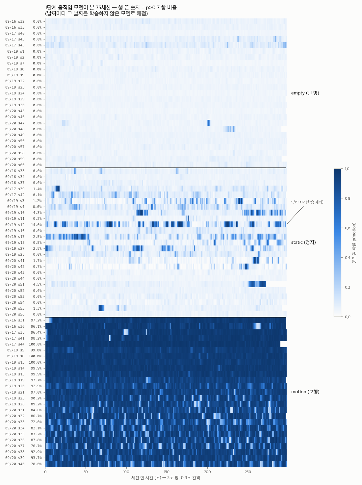
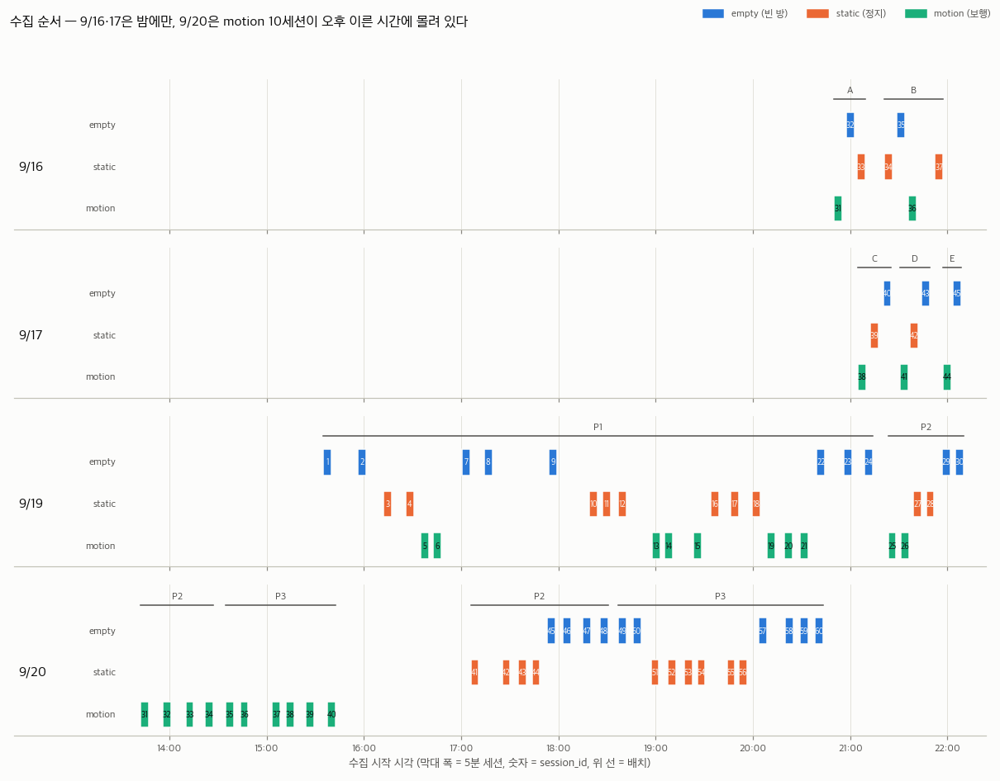

# 수집 데이터셋 공개 적합성 점검

> 상태: **SUPPORTING ANALYSIS** — 2026-10-23 점검, 2026-10-27 9/16·17 추가·방과 피험자 확인, 2026-10-30 empty 수집 조건 확인 반영
> 대상: `mac_collector_output/raw/` 의 9/16·17·19·20 **75세션**. 9/19·20 60세션은 현재 배포 모델의
> 학습 자료이고, 9/16·17 15세션은 파일럿·외부 평가 자료다. 6/15·16 구 데이터는 공개 대상에서
> 뺀다 (2026-10-27 결정).
> 범위: 원본 `.csi` 전수 검사, 라벨–신호 정합성, 실험 설계, 메타데이터, 공개 요건.
> 원본 `.csi`·`session.json`·스냅샷·registry·사진은 **읽기만 했고 바꾸지 않았다.**

## 1. 결론

**원시 데이터 자체는 공개해도 될 만큼 깨끗하다. 그러나 지금 폴더를 그대로 공개할 수는 없다.**
9/16·17 을 더해도 이 판단은 같다.

225개 파일 660만 프레임에서 손상·재부팅·순번 역행이 하나도 없고, 공식 품질 판정을 75세션
모두 통과했다. 9/16·17 파일은 10/1 점검 때와 해시가 모두 같다. 라벨도 빈 방 25세션은 깨끗하고,
정지 라벨 이상은 이미 학습에서 뺀 9/19 s12 한 건뿐이다. 반면 **공개 데이터의 필수 정보가 비어
있거나 틀려 있다.** 9/19·20 의 P1·P2·P3 배치 좌표가 없고, 9/16 사진은 측정한 방이 아닌 다른
방을 찍은 것이며, 날짜가 다른 세션끼리 session_id 가 겹친다. 메타데이터 오류도 여럿이고,
라이선스·피험자 동의·데이터 카드가 없다. 9장의 필수 항목을 채우면 **"피험자 2명·단일 공간 3-RX
파일럿 데이터셋"** 으로 공개할 수 있다. 일반화 데이터셋으로 내세우기에는 한계가 분명하다. 피험자
2명이 날짜와 완전히 겹치고(9/16·17 에 한 명, 9/19·20 에 다른 한 명), 방 1곳에서 나흘 찍었다.

| 영역 | 판정 | 핵심 근거 |
|---|---|---|
| 파일·프레임 무결성 | **공개 가능** | CRC 실패 0 / 6,596,401 프레임, 헤더 이상 0, manifest 프레임 수 225/225 일치, 9/16·17 해시가 10/1 점검과 75/75 동일 |
| 신호 품질 (수신율·동기) | **공개 가능, 한계 명시** | 3-RX 공통 프레임 87.4~97.7%, 공식 판정 75/75 통과. USB 직결 목표치(tx_cov > 0.99)는 196/225 파일이 미달 |
| 라벨 정합성 | **조건부** | empty 25/25 깨끗. static 은 9/19 s12 한 건이 정의 위반(움직임 창 14.6%). 9/16·17 은 motion 96~100%, static 최대 1.4%. 다만 static 과 empty 의 차이는 신호로 검증하기 어렵다 |
| 실험 설계 | **한계 명시 필요** | 클래스 수는 날짜마다 맞음. 피험자 2명이 날짜와 완전히 겹침(9/16·17 `S1`, 9/19·20 `JH`), 9/16·17 은 밤에만 수집, 9/20 motion 이 오후 이른 시간에 몰림, 품질 미달로 버리고 다시 찍은 세션이 있음 |
| 메타데이터 | **공개 전 수정 필수** | P1~P3 좌표 없음, 9/16 사진이 다른 방, session_id 가 날짜 간 중복(s31~s45), 피험자 ID `JH` 가 이니셜이고 9/16·17 은 피험자 필드 없음, s12 스냅샷 손상, `pipeline` 오기, `action` 어휘 잔존 |
| 공개 요건·패키징 | **미비 — 필수** | LICENSE·동의 기록·데이터 카드 없음, 원본 폴더에 실시간 산출물·`.DS_Store`, zip 에 `__MACOSX`·깨진 파일명 |

## 2. 점검 대상

| 묶음 | 내용 | 공개 대상 여부 |
|---|---|---|
| `raw/20260916/` | 7세션 (배치 A 3 + B 4), 20:50~21:57. 사진 3장 (`setting/`, 측정한 방이 아님 — 6장) | **대상** (사진 제외) |
| `raw/20260917/` | 8세션 (배치 C 3 + D 3 + E 2), 21:04~22:08. 사진 2장 (`setting/`) | **대상** |
| `raw/20260919/` | 30세션 (P1 24 + P2 6), 15:34~22:10 | **대상** |
| `raw/20260920/` | 30세션 (P2 12 + P3 18), 13:42~20:43 | **대상** |
| `raw/setting/P1~P3`, `sink-setting` | 9/19·20 배치 사진 (파일 생성일 9/22, 사람 없음, GPS EXIF 없음) | 대상 (부속 자료) |
| `raw/2차 수집.zip` | 9/19·20 과 `setting` 의 사본 (363 MB). 9/16·17 은 들어 있지 않다 | 배포본으로는 부적합 (8장) |
| `raw/20260615/`, `raw/20260616/` | 구 JSONL 34세션. 진폭만 저장했고 `session.json` 이 없으며, 라벨을 session_id 범위로 하드코딩했다 (1~10 empty → 11~20 static → 21~30 motion 순으로 몰아 찍음). CRC 없는 구 프레임 | **제외** (2026-10-27 결정) |
| `mac_collector_output/realtime/` | 실시간 24회 (`live` — 학습 라벨 아님) | 제외 |

배치 이름 A~E 는 9/16·17 파일럿 보고서가 붙인 것이다. 스냅샷에는 배치 이름 필드가 없다(6·7장).

대상 규모: 75세션 × 약 300초 = **약 6.3시간**, RX 3대 × 75 = 225파일, **6,596,401 프레임,
1,134,580,972 바이트**. 클래스당 25세션 (9/16·17 각 5, 9/19·20 각 20). 사람이 있는 세션은 피험자 `S1` 10개, `JH` 40개다.

## 3. 파일·프레임 무결성 — 공개 가능

공식 reader 의 검사와 별도로 모든 프레임을 다시 읽어 확인했다 (방법은 부록).

| 검사 | 결과 |
|---|---|
| 파일 크기가 172바이트(44 헤더 + 128 I/Q)의 배수 | 225/225 |
| magic·version 4·frame_type·total_len·raw_len 이상 | 0 |
| CRC-32 재계산 불일치 (1비트 변조로 검출 동작 확인) | **0 / 6,596,401** |
| 저장 프레임 수 = `session.json` 의 `frames` | 225/225 |
| channel 11 · rate 11 · sig_len 47 · raw_len 128 | 전 파일 단일값 |
| `rx_id` ↔ device (101→1, 102→3, 103→2) = manifest | 225/225 |
| 세션 중 RX 재부팅 (`boot_id` 변화) · `tx_seq` 역행 · RX timestamp 역행 | 0 · 0 · 0 |
| 가드 톤(0, 27~37)이 0 이 아닌 프레임 · 전부 0 인 프레임 · I/Q 포화(±127/−128) | 0 · 0 · 0 |
| 파일 내용 중복 (SHA-256) | 없음 |
| 9/16·17: 10/1 점검 기록([audit.json](../model_train/docs/model-training/assets/20260916-17-evaluation/audit.json))과 해시 대조 | `.csi` 45 + `session.json` 15 + 스냅샷 15 = **75/75 동일** |
| 9/19·20: `2차 수집.zip` 사본과 대조 (672파일) | 1파일만 다름 — s12 스냅샷 (7장) |
| 공식 판정 `measure_csi_hz.py` (crc·재부팅·tx_back·공통 85%) | **75/75 통과** |

9/16·17·19 에는 RX 3대와 TX 모두 하루 내내 재부팅이 없었다(보드별 `boot_id` 1개, `tx_seq` 계속
증가). 9/20 에는 세션 사이에 RX 재부팅이 있었고 TX 도 1회(s40 → s41, `tx_seq` 781,853 → 171,686)
재부팅됐으나, 모두 세션 경계 밖이다.

## 4. 신호 품질 — 공개 가능, 무선 업링크 한계는 명시

네 날짜 모두 USB 직결이 아니라 **ESP-NOW SINK 무선 업링크**로 수집했다(세 RX 가 같은 포트,
`sink_*` 카운터 존재). 수집 프로토콜 §7 의 주의 기준은 USB 직결 목표치라 대부분 미달하는 것이
정상이다. 불합격선(공통 85%)은 9/16·17 파일럿에서 채택·폐기 세션을 가른 실측으로 정했다.

| 지표 | 9/16·17 (45파일 / 15세션) | 9/19·20 (180파일 / 60세션) | 프로토콜 주의 기준 |
|---|---|---|---|
| RX 저장률 (파일마다 초당 저장 프레임 수) | 92.9~99.1 Hz (중앙 97.4) — 범위 밖 **13**/45파일 | 91.4~99.9 Hz (중앙 97.9) — 범위 밖 **25**/180파일 | 97~103 Hz (밖인 파일은 모두 97 미만) |
| `tx_cov` (RX별 tx_seq 관측률) | 0.929~0.991 (중앙 0.974) — 기준 미달 **44**/45파일 | 0.914~0.999 (중앙 0.979) — 기준 미달 **152**/180파일 | 0.99 초과 |
| `seq_gap` > 프레임의 1% | 1파일 | 4파일 | — |
| RSSI 중앙값 | −54 ~ −28 dBm — 범위 밖 **21**/45파일 | −54 ~ −31 dBm — 범위 밖 **47**/180파일 | −25~−40 dBm (밖인 파일은 모두 −40 보다 약함) |
| 3-RX 공통 프레임 / (수집 초 × 100) | **88.7~96.4% (중앙 93.7%)** | **87.4~97.7% (중앙 96.0%)** | 불합격선 85% → 전부 통과 |
| 공통 격자의 최장 공백 | 11프레임 이하 | 8프레임 이하 (s51 만 77프레임 = 0.77초) | — |
| 같은 프레임이 두 번 저장됨 | 676건, 44파일 | 1,290건, 147파일 | 전부 바이트 단위로 같은 연속 프레임 |
| 진폭 0 인 데이터 톤을 포함한 프레임 | 26파일, 최악 9/16 s37 RX101 23.9% | 117파일, 최악 s4 RX102 31.4%, s18 RX101 20.4% | — |
| 펌웨어 링버퍼 드롭 · SINK 드롭 | 0 · 0 | 9/20 s51 RX101·102 만 290·30 · 0 | — |

- **가장 나쁜 세션은 9/20 s51 (static)** 이다. RX101·102 펌웨어 링버퍼 드롭이 290·30건이고,
  두 RX 의 스트림이 RX103 보다 3.3~3.9초 먼저 끊겼다. 그래도 공통 87.4%로 판정과 공식 전처리의
  공통 구간 기준(27,000)을 통과한다.
- **9/16·17 에서 가장 낮은 세션은 9/17 s45 (88.7%)** 다. 9/17 후반으로 갈수록 RX103 저장률이
  떨어졌다: 배치 C 98.4~99.1 Hz → s41 93.9 Hz → s44 93.6 Hz → s45 92.9 Hz. 수집 기록은 RX103
  보드 이상(안테나·커넥터)을 의심했다. 같은 시각 배치 E 의 static 두 번은 RX103 수신이 무너져
  버렸다(6장).
- **중복 프레임**은 업링크 재전송으로 보이며, 소비자는 `tx_seq` 중복을 첫 프레임만 남겨야 한다
  (기존 정렬 코드가 그렇게 한다). 공개 문서에 이 규칙을 적어야 한다.
- **진폭 0 톤**은 약한 톤이 int8 로 양자화된 결과로 보인다. 진폭에는 문제가 작지만 그 자리의
  위상은 정의되지 않으므로 위상을 쓰는 사용자에게 알려야 한다.
- 수신 손실이 라벨과 엮여 있지는 않다. 날짜·클래스별 평균 공통 비율이 92.4~96.3%다. 같은 날짜
  안에서 가장 크게 벌어진 경우가 9/17 의 static 95.7% 와 motion 92.4% 인데, 세션이 2~3개뿐이라
  "누락률로 라벨을 맞히는" 지름길로 보기는 어렵다. 9/17 만으로 평가할 때는 확인해야 한다.

## 5. 라벨 정합성 — empty 는 깨끗, static 은 정의 문서화 필요

폴더 이름과 `session.json` 의 `label` 이 75/75 일치한다. 9/19·20 은 스냅샷의 `label_target` 도
60/60 일치하지만, **9/16·17 스냅샷의 `label_target` 은 15세션 모두 `"empty"`** 다(수집 프롬프트의
기본값). 그래서 10세션에서 실제 라벨과 다르다. 라벨은 `session.json` 에서만 읽어야 한다.

신호가 라벨과 맞는지는 **1단계 움직임 모델**(3초 창, `model_train/amp60/`)로 75세션을 같은
기준으로 다시 채점해 확인했다. 날짜마다 그 날짜를 학습하지 않은 모델을 썼다.

아래의 학습 날짜·세션 수는 각 저장 모델의 학습 기록을 확인한 값이다.
파일명의 `wo`는 `without`의 줄임말로, 뒤에 적힌 날짜를 학습에서 제외했다는 뜻이다.

| 검사할 데이터(평가 날짜) | 사용한 모델 | 모델 학습에 사용한 데이터 | 학습 세션 수 |
|---|---|---|---:|
| 9/16·17 | `model_motion3s_wo1617.pt` | **9/19·20** 자료. 9/19 s12는 학습에서 제외 | **59** |
| 9/19 | `model_motion3s_wo19.pt` | **9/16·17·20** 자료. 9/19 자료는 학습에 사용하지 않음 | **45** |
| 9/20 | `model_motion3s.pt` | **9/16·17·19** 자료. 9/20 자료는 학습에 사용하지 않음 | **45** |

예를 들어 9/19 자료의 라벨을 검사할 때는 **9/16·17·20으로 학습한 가운데 모델**에
9/19 신호를 넣어 움직임 확률을 계산했다. 검사 대상 날짜를 학습한 모델로 그 날짜를
다시 검사하면 이미 본 자료의 특성을 외운 결과일 수 있어, 날짜마다 모델을 바꿨다.

s12 제외 목록도 끄고 모든 세션을 똑같이 채점했다(74,145 창). 9/19·20 수치는 10/23 점검과 똑같이
재현됐다.



| 라벨 | p(motion) > 0.7 인 창 비율 | 해석 |
|---|---|---|
| empty | **25세션 모두 0.0%** | 빈 방 세션에 사람 움직임 흔적 없음 |
| static | 9/16·17: 0.0~1.4% (s39 1.4%, s42 0.1%, 나머지 0). 9/19·20: 중앙 0.35%, **s12 14.6%**, 다음 s51 4.5% · s10 4.3% · s27 2.8% · s17 2.5% | s12 만 뚜렷한 이상치 (다음 세션의 3.2배) |
| motion | 9/16·17: 96.1~100%. 9/19: 89.2~100%. 9/20: 72.6~93.7% | 자유 보행이라 멈춘 구간이 섞임 |

- **s12 제외는 균일 기준으로도 정당하다.** 기존 결정(`scripts/train_sessions.EXCLUDED_SESSIONS`)은
  s12 를 학습한 모델의 5.1% 로 내려졌는데, 학습하지 않은 모델로 다시 재도 14.6%로 다른 static
  세션과 확연히 갈린다. 다만 **제외 문턱이 숫자로 정해져 있지 않다.** 공개본에는 75세션을 모두
  싣고 `quality_flag` 로 s12 를 표시하거나, 문턱을 정해 모든 세션에 같이 적용해야 한다.
- **static 과 empty 의 구분은 신호로 검증하기 어렵다.** 움직임 모델이 확인하는 것은 "움직임이
  없다"는 것까지다. 정지한 사람이 실제로 있었는지는 운영자 기록에 의존한다.
  - 단순 특징 최근접 중심의 세션 LOSO 정확도로 empty/static 은 75세션 기준 0.708 이고,
    9/16·17 만으로는 0.563 으로 사실상 구분이 되지 않는다.
  - 30초 robust 모델도 9/16·17 에서 static s33·s37 을 empty 로, empty s43 을 static 으로
    판정했다(세션 12/15).
  - 사람이 있었다는 신호상 간접 근거는 9/17 s39 정도다. 피험자가 RX102 시야를 가려 RX102 RSSI 가
    −51 dBm 으로, 다른 RX(−45/−34)보다 뚜렷이 약했다.
  - 데이터 카드에 "static 라벨은 운영자 기록 기준이며 신호로 독립 검증하지 않았다"고 적는다.
- **static 의 실제 내용은 프로토콜 정의("호흡 외 움직임 없음")보다 넓다.**
  - 9/19·20 운영 메모: 서서 작은 움직임(s3, s12, s27, s28), 서서 휴대폰 사용(s4, s17, s18),
    서 있음(s41, s42, s53, s54), 의자에 앉아 휴대폰·이어폰 사용(s10, s11), 의자에 앉음(s16, s43,
    s44, s51, s52), 바닥에 앉음(s55, s56).
  - 9/16·17 은 세션별 기록이 거의 없다. 수집 기록과 사후 메모에 있는 것은 s37(TX–RX101 직선 위
    정지), s39(RX102 시야를 몸으로 가린 채 정지), s42(RX101 쪽에 앉음)뿐이고, s33·s34 는 자세
    기록이 없다.
  - 공개 라벨 정의는 **"사람이 있으나 걷지 않음"** 으로 적고 자세를 세션별 필드로 줘야 한다.
  - 9/20 s51 은 끝부분(약 250~272초)에 움직임 구간이 있다.
- **motion 도 강도가 섞여 있다** — 걷기, 뛰기·격렬한 활동(9/19·20 의 s6, s14, s21, s26, s32,
  s36, s38), 중간 강도(s34). 9/16·17 은 "구역 안 자유 보행"이라는 공통 지시만 있다. 라벨은 세션
  단위이며 창마다 움직임이 보장되지 않는다.
- **empty 25세션은 모두 운영자가 방(6 m × 7 m) 밖으로 완전히 나간 상태에서 수집했다.**
  9/16·17·19·20의 모든 empty 세션에 해당한다(2026-10-30 사용자 확인).
  공개 설명에도 이 수집 조건과 운영자 확인에 근거한 라벨임을 명시한다.
- 참고 수치 (기준선으로 함께 줄 수 있다):
  - 단순 특징 최근접 중심(`check_separability.py`, 세션 LOSO)의 3-class 정확도는 75세션 0.714
    (9/19·20 만 0.718, 9/16·17 만 0.665)로 "약하게 갈림" 이다.
  - 30초 공유 인코더 모델은 9/19·20 의 날짜·배치 제외 평가에서 세션 60/60, 9/16·17 에서는
    12/15 였다 ([모델 결과](../model_train/docs/model-training/robust-three-class-report.md),
    [9/16·17 평가](../model_train/docs/model-training/archive/20260916-17-model-evaluation.md)).
    9/16·17 평가는 학습 자료와 날짜·배치뿐 아니라 피험자도 다른 평가다.

## 6. 실험 설계와 교란 요인 — 한계로 명시

| 날짜 · 배치 | empty | static | motion |
|---|---:|---:|---:|
| 9/16 · A | 1 | 1 | 1 |
| 9/16 · B | 1 | 2 | 1 |
| 9/17 · C | 1 | 1 | 1 |
| 9/17 · D | 1 | 1 | 1 |
| 9/17 · E | 1 | 0 | 1 |
| 9/19 · P1 | 8 | 8 | 8 |
| 9/19 · P2 | 2 | 2 | 2 |
| 9/20 · P2 | 4 | 4 | 4 |
| 9/20 · P3 | 6 | 6 | 6 |

9/16·17 배치 좌표는 세션별 registry 스냅샷에 있다. 측정 구역 3 m × 3 m 기준이고, 높이는 모두
1.2 m, TX 는 (1.5, 1.5) 에 고정했다.

| 배치 | 세션 | RX101 | RX102 | RX103 | 비고 |
|---|---|---|---|---|---|
| A | 9/16 s31~s33 | (0.2, 2.8) | (2.8, 2.8) | (1.5, 0.2) | Y자. 좌표는 다음 날 소급 기록 |
| B | 9/16 s34~s37 | (2.8, 1.2) | (0.2, 0.5) | (0.2, 2.3) | RX 만 재배치. 좌표는 다음 날 소급 기록 |
| C | 9/17 s38~s40 | (0.2, 2.8) | (2.8, 1.5) | (0.2, 0.2) | SINK (1.5, −0.5) — registry 에 필드 없음 |
| D | 9/17 s41~s43 | C 와 같음 | C 와 같음 | C 와 같음 | RX 윗면을 벽쪽으로 회전, 각도 미기록 |
| E | 9/17 s44~s45 | (2.8, 2.8) | (0.2, 1.5) | (2.8, 0.2) | C 를 좌우 대칭(x → 3 − x) |

9/19·20 은 조건마다 세 클래스가 같은 수로 있어 날짜 제외·배치 제외 평가가 가능하다. 9/16·17 은
배치당 1세션씩이라 배치 제외가 사실상 세션 제외이고, E 에는 static 이 없다. 그 밖에:



- **방은 네 날짜 모두 같지만, 9/16 사진은 측정한 방이 아니다.** 9/16·17 은 9/19·20 과 같은
  방(6 m × 7 m)에서 찍었다(메타·수집 기록, 2026-10-27 사용자 확인). 9/16 은 책상이 많은 상태였다.
  그런데 `20260916/setting/` 사진 3장은 다른 방을 찍은 것이다.
  - 9/16 사진: 런던 버스 벽화, 블라인드를 올린 어두운 창, 천장 프로젝터 없음
  - 9/17·19·20 사진: 세계 지도 벽화, 인쇄된 블라인드 창, 천장 프로젝터
  - 이 사진을 9/16 배치 자료로 실으면 사용자가 방이 2곳이라고 읽는다. 공개본에서 빼거나 실제
    측정 방 사진으로 바꿔야 한다.
- **블록 무작위화(프로토콜 §4)가 지켜지지 않았다.**
  - 9/19 는 같은 클래스를 2~3개씩 묶어 찍었다.
  - 9/20 은 **motion 10세션(s31~s40)이 전부 13:42~15:37** 에, static·empty 20세션이 17:05~20:43 에
    찍혔다. 수집 커밋에 `블록 순서 뽑기` 기능이 이미 있었다. 9/20 안에서는 motion 과 시간대·수집
    순서가 완전히 겹치므로, 9/20 만 쓰는 평가는 이 교란을 피할 수 없다.
  - 9/17 은 주기마다 motion 을 먼저 찍었다. C·D 는 motion → static → empty 의 같은 순서였다
    (헤드리스 스크립트로 수집, 순서는 손으로 정함).
  - 9/16·17 은 모두 밤(20:50~22:08)에 찍혀 오후·저녁에 찍은 9/19·20 과 시간대가 다르다.
- **품질 미달로 버리고 다시 찍은 세션이 있다.** 공개 대상은 채택한 세션뿐이다.
  - 9/16: s28(motion, 수신 품질 미달 → s31 로 재촬영), s30(30초 진단), s37 첫 시도(피험자가 크게
    움직임)를 버렸다.
  - 9/17 배치 E: static 을 두 번 버렸다. 피험자가 TX 바로 앞에서 TX 를 가렸거나 RX103 수신이
    무너져, 공통 구간이 24,085·23,277 프레임으로 기준(27,000)에 못 미쳤다.
  - 남은 자료는 수신 품질로 고른 것이라 "사람이 TX 를 가리는 정지" 같은 어려운 조건이 빠져 있다.
- **9/20 의 배치가 P2 → P3 → P2 → P3 로 오갔다.** 두 번째 P2 앞에서 TX 가 재부팅됐다(3장).
  같은 P2 라도 다시 설치한 것이라 위치가 같다는 기록이 없다.
- **같은 배치 안에서도 RX·TX 방향이 자주 바뀌었다.** 9/19·20 에서 45° 회전(s2, s4), 바닥과
  수평(s8), 180° 회전(s17), 임의 각도 + 15° 기울임(s18~s20), 뒤집기 −15°(s21, s22), 벽 방향 +
  TX 180°(s23), TX 반대 방향(s40), 임의 회전(s24, s33, s34, s39, s47, s48, s58) — 자유 메모에만
  있다. "P1" 은 하나의 고정 기하가 아니다. 의자·책상 배치도 세션마다 바뀌었고, 9/16 은 9/17 보다
  책상이 많은 상태였다.
- **피험자는 2명이고, 날짜와 완전히 겹친다.** 9/16·17 은 `S1`(메모 "피험자 1명(S1 로 기록)"),
  9/19·20 occupied 40세션은 모두 `subject_id` `JH` 이고, 두 사람은 다른 사람이다(2026-10-27 사용자
  확인).
  - 피험자마다 날짜·배치·시간대가 따로 정해져 있어, 사람 효과를 이들 효과와 분리할 수 없다.
  - 2명으로는 사람 간 일반화를 주장할 수 없다.
  - 9/19·20 으로 학습해 9/16·17 로 평가하면 사람까지 바뀐 평가가 된다.
- **휴대폰·블루투스 이어폰 사용이 날짜와 엮여 있다.** 9/19 는 occupied 20세션 중 12세션
  메모에 휴대폰 사용이 있고(이어폰 s11, s25, s26), 9/20 은 s32 를 빼면 "휴대폰 x" 다. 9/16·17 은
  기록이 없다. 2.4 GHz 송신원이 사람과 함께만 존재하는 공변량이므로 공개 메타데이터에 넣어야 한다.

## 7. 메타데이터·출처 — 공개 전 수정 필수

| 문제 | 근거 | 영향 |
|---|---|---|
| **9/16 사진이 측정한 방이 아님** | 6장. 방은 같다고 확인됐다 | 9/16 배치 자료로 잘못 읽힌다. 공개본에서 빼거나 바꿔야 한다 |
| **P1·P2·P3 좌표가 없다** | 9/19·20 의 `device_registry_snapshot.csv`·`tx_registry_snapshot.csv` 60개가 해시까지 같고, 내용은 9/17 배치 E 값, `orientation_deg` 0 | 배치도를 그릴 수 없다. 배치 정보는 `setting/` 사진뿐이고 P2·P3 에는 TX 사진도 없다 |
| **9/16·17 배치 이름이 없다** | 스냅샷에 `placement_id` 필드가 없다(9/19 이전 형식). 배치는 registry 스냅샷 내용으로만 구분된다. 9/16 의 registry 스냅샷은 스냅샷 기능 커밋(`4aafb2a`, 9/17 20:50) 직후에 "대화 기반 소급 기록"이라는 비고와 함께 들어갔다 | A~E 를 공개 배치 표에 올리고, 9/16 좌표가 소급 기록임을 표시해야 한다 |
| **session_id 가 날짜를 건너 겹친다** | 9/16·17 의 s31~s45 와 9/20 의 s31~s45 가 같은 번호다. 9/19 는 s1 부터 다시 시작한다 | 번호만으로 세션을 고르면 다른 날짜가 섞인다. 공개 ID 는 `20260916-s31` 처럼 날짜를 붙인다 |
| **피험자 ID** | 9/16·17 은 자유 메모에만 `S1`(필드 없음), 9/19·20 `subject_id` 는 이니셜 형태(`JH`). 두 사람은 다르다. 프로토콜 §9 는 `S1` 같은 익명 코드를 요구 | 개인 식별 가능성. `JH` 를 익명 코드로 바꾸고, 9/16·17 세션에도 피험자 값을 채워야 한다 |
| **s12 스냅샷 손상** | `20260919/183645_static_s12/session_meta_snapshot.yaml` 첫 글자 앞에 `ㄴ`(U+3134)이 붙어 YAML 파싱 실패. 수정 시각 2026-10-12 23:10 (수집 뒤). zip 사본은 정상 | 공개 후 사용자 로더가 이 세션에서 실패한다 |
| 스냅샷이 수집 뒤에 고쳐짐 | 9/17 s39·s42 는 세션이 끝나고 몇 분 안에 "[세션 s39 전용]" 같은 메모가 덧붙었다(수집 기록과 내용 일치). s12 는 3주 뒤 손상됐다 | 스냅샷이 "수집 시점 그대로"라는 보장이 없다. 사후 메모는 별도 필드로 둬야 한다 |
| 9/16·17 의 `label_target` | 15/15 가 `"empty"` (5장) | 라벨로 오해할 수 있다. `session.json` 만 라벨로 쓴다 |
| **`pipeline: "usb"` 오기** | 75/75 가 `usb` 지만 실제는 SINK 무선 업링크. `csi_session.create_session()` 기본값이 그대로 들어감 | 전송 방식이 손실·중복 특성을 결정하므로 사용자가 오해한다 |
| **라벨 어휘 `action` 잔존** | 9/19·20 스냅샷 60개의 주석이 `(empty / static / action)`. `collection-protocol.md` §5, 현재 `session_meta.yaml` 주석도 같음. 9/16·17 주석은 `motion` | 공개 라벨 어휘와 다르다 |
| 세션 메모 위치 | `session_note` 사용 0/75. 세션별 메모가 전역 필드 `operator.notes` 에 들어감 | 자유 문장이라 기계가 읽을 수 없다 |
| 기록되지 않은 값 | 시작 지연 값, empty 때 운영자 위치, 문·창문 상태, static 위치·motion 범위의 좌표. 9/16·17 은 자세·휴대폰 사용도 없다 | 프로토콜 §9 가 요구한 항목 |
| 출처 재현 불가 | `git_dirty: true` 75/75 (9/16 `19696a3-dirty`, 9/17 `4aafb2a-dirty`, 9/19·20 `f1f08cf-dirty`, 세 커밋은 저장소에 있음). 9/16·17 은 CLI·제어판이 아닌 헤드리스 스크립트로 수집. 펌웨어 식별은 `"meshsense"` 문자열뿐 | 어떤 코드·펌웨어로 찍었는지 바이트 단위로 재구성할 수 없다 |

## 8. 공개 요건·패키징 — 미비

- **라이선스가 없다.** 저장소에 `LICENSE` 가 없고 데이터 이용 조건도 정해지지 않았다.
- **피험자 동의 기록이 없다.** 사람이 나오는 측정 데이터를 공개하려면 공개에 대한 동의를 받아야
  한다. 기관 규정상 심의가 필요한지도 확인해야 한다.
- **데이터 카드가 없다.** 형식 설명은 [데이터 규격](data-schema.md)이 좋은 바탕이지만 수집 환경·
  라벨 정의·알려진 문제·권장 분할·인용 방법이 없다.
- **배치 사진**
  - 사람과 위치 정보(GPS EXIF)는 없다.
  - 9/17·19·20 사진에는 기관 로고가 인쇄된 블라인드와 벽 게시물이 보인다. 촬영 장소를 드러내도
    되는지 정해야 한다.
  - 9/16·17 사진 5장은 1024×768 로 다시 저장된 파일이다(파일 생성 10/27, 카메라 정보 없음). 촬영
    날짜를 파일로 확인할 수 없다. 그중 9/16 사진 3장은 다른 방이다(6장).
  - 9/17 사진 1장에 촬영자의 무릎이, 9/16·17 사진 2장에 노트북 화면이 찍혀 있다. 화면 글자는
    읽히지 않는다.
- **원본 폴더에 원본이 아닌 파일이 섞여 있다.**
  - `20260917/211235_static_s39/`·`214412_empty_s43/`: 실시간 판단을 재생한 산출물
    (`realtime_events.jsonl`·`realtime_status.json`·`realtime_marks.jsonl`, 10/1 생성)
  - 네 날짜 폴더: `.DS_Store` 106개
  - 9/19·20 세션 60개: 파생 그림 `csi_waterfall.png`
- **zip 은 배포본으로 쓸 수 없다.** `__MACOSX/` 항목 843개, `.DS_Store` 109개가 들어 있고,
  `전체 배치.jpeg` 이름이 zip 안에서 깨진다(UTF-8 플래그 없음). 9/16·17 은 들어 있지 않다.
- **로더**: `scripts/csi_store.py` 는 numpy 만 쓰므로 그대로 동봉할 수 있다.

## 9. 공개 전 해야 할 일

**필수** — 아래가 끝나기 전에는 공개하지 않는다.

1. **9/16 사진 정리**: 9/16 은 같은 방으로 확인됐으므로, 다른 방을 찍은 `20260916/setting/` 사진
   3장은 공개본에서 빼거나 실제 측정 방 사진으로 바꾼다.
2. **배치 기하 기록**: P1·P2·P3 의 RX 3대·TX·SINK 좌표, 높이, 방향을 사진과 기억으로 복원한다.
   그리고 A~E 와 함께 `placements.csv` 하나로 만든다. 복원할 수 없는 값(D 의 회전각 등)은
   "미기록", 9/16 좌표는 "소급 기록"으로 적는다.
3. **세션 표 하나로 정리**: 열은 날짜를 붙인 전역 ID(`20260916-s31`), 날짜, 시작 시각, 배치,
   피험자, 라벨, 자세(서기/의자/바닥), 활동 강도(걷기/뛰기), 휴대폰·이어폰, 가구, RX·TX 방향 변경,
   `quality_flag` 로 둔다. 자유 메모에서 옮기고 공개용으로 영어 번역을 붙인다.
4. **메타데이터 오류 수정** (원본은 그대로 두고 공개 사본에서):
   - s12 스냅샷은 zip 사본으로 복구한다.
   - 전송 방식은 `sink_uplink` 로, 어휘 주석의 `action` 은 `motion` 으로 고친다.
   - 9/16·17 의 `label_target` 은 라벨이 아니라고 표시한다.
5. **s12 처리 결정**: 공개본에 포함하고 플래그로 표시(권장)하거나, 문턱을 정해 모든 세션에 적용.
6. **개인정보·동의**: 피험자를 익명 코드 `S1`(9/16·17)·`S2`(9/19·20, 현재 `JH`)로 정리하고, 두
   사람 모두에게 공개 동의를 받는다. 사진의 기관 표식·촬영자 신체·노트북 화면 처리를 정한다.
7. **라이선스 선택** (예: CC BY 4.0 — 결정은 프로젝트 몫).
8. **배포 묶음**:
   - 원본 파일만 담는다(`.csi`, `session.json`, 스냅샷, registry 스냅샷, 사진).
   - 실시간 산출물·파생 그림·`__MACOSX`·`.DS_Store` 는 넣지 않는다. 파일명은 ASCII 로 한다.
   - 파일별 SHA-256 목록, 로더, 데이터 카드(10장 한계 포함), 권장 분할을 함께 싣는다.

**권장**

- 권장 분할은 날짜 제외(4겹)와 배치 제외다. 피험자 제외 분할은 9/16·17 ↔ 9/19·20 하나뿐이고,
  날짜·배치·시간대도 함께 바뀐다. 9/16·17 은 파일럿 모델 비교, 1단계 움직임 모델 학습,
  robust 모델 외부 평가에 이미 쓰였다. 따라서 "한 번도 보지 않은 시험셋"으로 내세우지 않는다.
- 수집 도구 보완: `pipeline` 을 실제 전송 방식으로 기록, 시작 지연 값을 manifest 에 기록,
  세션 메모를 `session_note` 로, 스냅샷 수정 방지(읽기 전용 또는 해시 기록), 실시간 재생 산출물을
  원본 세션 폴더 밖에 쓰기.
- 다음 수집부터 블록 순서 뽑기를 실제로 쓰고, 피험자·방을 늘리고, 버린 세션도 사유와 함께
  목록으로 남긴다.

## 10. 데이터 카드에 반드시 적을 한계

- 피험자 2명(9/16·17 에 한 명, 9/19·20 에 다른 한 명), 방 1곳, 나흘, 배치 8개(A~E, P1~P3),
  약 6.3시간. 피험자가 날짜와 완전히 겹쳐 사람 효과를 따로 볼 수 없다. 사람·공간 일반화 근거가
  아니다.
- 라벨은 5분 세션 단위다. motion 에는 멈춘 구간이, static 에는 작은 움직임·휴대폰 사용이 있다.
  static 라벨은 운영자 기록 기준이며 신호로 독립 검증되지 않았다.
- 9/20 의 motion 은 모두 오후 이른 시간에 찍혀 시간대·순서와 겹친다. 9/16·17 은 밤에만 찍었고
  9/17 은 순서가 고정이었다.
- 수신 품질로 고르고 다시 찍은 세션이 있어 어려운 정지 조건(TX 가림 등)이 빠져 있다.
- 무선 업링크라 RX 별로 프레임이 최대 약 9%(중앙 2%) 빠져 있고, 일부 프레임이 두 번 저장돼 있다.
  `tx_seq` 로 정렬하고 중복은 첫 프레임만 쓴다. RX 별 `seq`·`timestamp_us` 는 공유 시계가 아니다.
  9/17 후반에는 RX103 수신이 떨어졌다.
- 같은 배치 안에서도 RX·TX 방향과 가구가 세션마다 바뀌었다.
- 휴대폰·블루투스 사용 여부가 날짜에 따라 다르고, 9/16·17 은 기록이 없다.
- 수집 코드가 커밋되지 않은 상태(`git_dirty`)였고, 9/16·17 은 헤드리스 스크립트로 수집했다.

## 부록 — 재현 방법

공식 도구:

```bash
# 공식 품질 판정 (세션마다)
for d in mac_collector_output/raw/202609{16,17,19,20}/*_s*/; do
  .venv/bin/python scripts/measure_csi_hz.py "$d"
done
# 단순 특징 분리 가능성 (세션 LOSO). 6/15·16 은 session.json 이 없어 자동으로 빠진다
.venv/bin/python scripts/check_separability.py --out separability.png
# 날짜 일부만 보려면 날짜 폴더를 심볼릭 링크로 모은 디렉터리를 --raw-root 로 준다
```

독립 검사 (이번 점검용으로 작성, 저장소에는 넣지 않았다):

- **프레임 전수 검사**: `csi_store.CSI_FRAME_DTYPE` 으로 파일을 읽고 프레임마다 crc32 필드를 0 으로
  둔 zlib CRC-32 를 다시 계산했다. 헤더 필드 값 집합, `seq`·`tx_seq`·`timestamp_us` 의 차분(역행·
  중복·공백), 톤별 진폭(가드 톤 0, 데이터 톤 0, ±127/−128 포화), 파일 SHA-256 을 모았다. `tx_seq`
  중복 프레임은 앞 프레임과 172바이트를 그대로 비교했다. 3-RX 공통 프레임은 RX 별 고유 `tx_seq`
  의 교집합 크기다.
- **해시 대조**: 9/16·17 은 10/1 점검 기록(`audit.json`)의 파일별 SHA-256 과, 9/19·20 은 zip 항목과
  NFC 이름 정규화 후 SHA-256 으로 비교했다.
- **움직임 재채점**: `model_train/amp60/train.py` 의 `load_sessions`·`batch_input`·`build` 를 그대로
  쓰되 제외 목록을 끄고 캐시를 저장소 밖에 두었다. 창 300프레임, 간격 30프레임, seed 3개 softmax
  평균. 체크포인트의 `training_dates` 에 평가 날짜가 없음을 assert 로 확인했다.
- **설계·메타데이터**: `session.json` 시작 시각, 스냅샷의 `placement_id`·`subject_id`·`operator.notes`,
  registry 스냅샷 해시와 내용을 세션별로 모았다. 9/16·17 배치는 registry 스냅샷 내용이 바뀌는
  지점으로 나눴다. 파일 수정 시각은 원본 시각보다 16시간 앞당겨 보이는 파일이 있어, 시각 비교에는
  `session.json` 의 시각과 커밋 시각을 함께 썼다.
