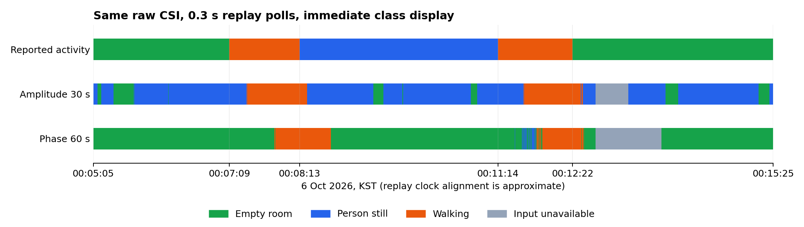

# 10월 6일 실시간 원본의 진폭·위상 전환 재생 비교

> 상태: **SUPPORTING ANALYSIS — 두 모델 재생·비교 완료**
> 실행일: 2026-10-08. [위상 모델 도입 작업 목록](../../../doc/plans/2026-10-08-phase60-introduction.md)의 2번.

## 결론

**위상은 빈 방을 잘 구분했지만, 앉아 있는 사람을 빈 방으로 판단했다. 기본 모델 교체는 보류한다.**
위상 모델의 9/16·17 세션 정답률 14/15가 실제 전환에서의 안정성을 보장하지는 않았다.
이번 10/6 원본에서 정지로 간주한 181초 동안 위상은 정지 표시를 한 번도 하지 않았다.
이후 상태 전환 후 첫 60초를 제외해도 정지 오판이 남았다.

후속 [원인 분석](20261008-phase60-static-diagnosis.md)에서 학습 정지와 이번 앉기 입력의
시간 패턴 차이와 모델의 의존성을 확인했다. 단순 변화량 부족만으로 설명할 수 없으며 물리적 세부 원인은 미확정이다.

이 평가는 새로 보드를 켠 실시간 시험이 아니라 **같은 원본으로 만든 두 모델의 순차 재생**이다.
실제 화면 지연과 원본 파일의 도착 시각을 복원할 수 없으므로, 행동 시각과의 정렬은 근사다.
세션 정답률과 아래의 시간 기준 표시 일치율은 서로 다른 지표다.

## 상태별 비교

아래 비율은 각 실제 행동 구간에서 **판단 가능한 시간 중 올바른 상태를 표시한 비율**이다.
판단 불가 시간은 비율의 분모에서 빼되 별도 열과 전체 시간 지표에서 공개한다.

| 실제 행동 | 구간 길이 | 진폭 30초 일치율 | 위상 60초 일치율 | 판단 불가: 진폭 / 위상 |
|---|---:|---:|---:|---:|
| 첫 빈 방 | 124초 | 18.15% | **100%** | 0 / 0초 |
| 첫 걷기 | 64초 | **74.98%** | 35.61% | 0 / 0초 |
| 앉아서 정지(근사) | 181초 | **87.73%** | **0%** | 0 / 0초 |
| 두 번째 걷기 | 68초 | **65.28%** | 44.54% | 0 / 0초 |
| 마지막 빈 방 | 183초 | 13.73% | **92.43%** | 30 / 60초 |

위상은 앉기 구간의 **152.19초를 빈 방, 28.81초를 움직임**으로 표시했다.
진폭은 그 구간에서 158.79초를 정지로 맞혔지만, 두 빈 방 구간은 주로 정지로 틀렸다.
두 모델 모두 현재 방에서 세 상태를 안정적으로 구분한다고 보기 어렵다.

### 전체 620초를 보면

| 지표 | 진폭 30초 | 위상 60초 |
|---|---:|---:|
| 정답 표시 시간 | 294.66초 | 290.76초 |
| 오답 표시 시간 | 295.34초 | 269.24초 |
| 판단 불가 시간 | 30초 | 60초 |
| 판단 가능한 시간 | 590초 | 560초 |
| 판단 가능한 시간 중 일치율 | 49.94% | 51.92% |
| **판단 불가도 포함한 전체 시간 중 일치율** | **47.53%** | **46.90%** |

위상의 51.92%만 보고 더 좋다고 판단하면 안 된다. 판단 불가로 빠진 시간이 두 배라
분모가 다르며, 전체 620초에서 실제 정답 표시는 위상이 약 3.90초 적었다.

## 행동 전환 후 반응

추가 확신 기준이나 유지 시간은 적용하지 않았다. `10초 연속 정답`은 분석용 지표다.
아래의 안정 시작 지연에 10초를 더하면 그 유지가 확인되는 시점이다.

| 행동 시작 | 첫 정답 지연: 진폭 / 위상 | 첫 10초 연속 정답 구간의 시작 지연: 진폭 / 위상 |
|---|---:|---:|
| 첫 빈 방 | 3.81 / 0초 | 18.51 / 0초 |
| 입실·첫 걷기 | 15.71 / **40.91초** | 16.31 / 42.11초 |
| 앉기 시작 | 6.91 / **없음** | 6.91 / **없음** |
| 걷기 재개 | 23.31 / **35.01초** | 23.91 / 41.61초 |
| 퇴실·마지막 빈 방 | 84.91 / **6.91초** | 84.91 / 10.51초 |

첫 빈 방의 위상 0초는 평가 시작 때 이미 빈 방으로 표시하고 있었다는 뜻이다.
반응 지연이 항상 0이라는 뜻은 아니다. 앉기 시작 시각은 완전 정지 시각이 아니므로
정지 반응은 근사다. 숫자의 소수점은 계산 결과이며 실제 행동을 그 정밀도로 측정하지 않았다.

### 각 전환 후 첫 60초를 제외한 보조 결과

주 결과를 바꾸지 않고, 두 모델에 똑같이 60초 제외 규칙을 적용했다.

| 실제 행동 | 남은 길이 | 진폭 일치율 | 위상 일치율 | 위상 판단 불가 |
|---|---:|---:|---:|---:|
| 첫 빈 방 | 64초 | 0.47% | 100% | 0초 |
| 첫 걷기 | 4초 | 100% | 100% | 0초 |
| 앉아서 정지(근사) | 121초 | 87.36% | **0%** | 0초 |
| 두 번째 걷기 | 8초 | 100% | 100% | 0초 |
| 마지막 빈 방 | 123초 | 17.07% | 100% | 21.01초 |

걷기의 남은 4초·8초는 매우 짧다. 위상이 걷기를 일반적으로 100% 맞힌다고 주장할 수 없다.
정지 구간은 60초가 지난 뒤에도 계속 빈 방으로 오판했으므로, 이전 걷기가 60초 창에 섞였다는
설명만으로 이 오류를 해결할 수 없다. 원인은 추가 진단이 필요하다.

## 입력 누락과 두 가지 재생 방식

RX103의 `tx_seq=120768 → 120775` 사이에 **6프레임 누락**이 있다.
보간 한도 5프레임을 넘으므로 이 누락을 포함하는 창은 판단하지 않았다.
이번 근사 시간축에서는 두 모델 모두 약 00:12:43.01에 판단 불가가 시작했고,
진폭은 00:13:13.01, 위상은 00:13:43.01에 복구됐다. 각각 **30초·60초**다.

| 재생 방식 | 진폭: 판단 가능 시간 중 / 전체 시간 중 일치율 | 위상: 판단 가능 시간 중 / 전체 시간 중 일치율 |
|---|---:|---:|
| **원본 prefix 순차 재생 — 주 결과** | 49.94% / 47.53% | 51.92% / 46.90% |
| 완성 파일 전체를 먼저 읽은 재생 | 50.10% / 47.67% | 51.76% / 46.75% |

순차 재생에서는 각 0.3초 시점까지의 프레임으로 최신 3-RX 공통 끝을 구한다.
새 공통 입력이 30프레임 미만이면 기존 표시를 유지한다. 전체 파일 재생에서는
고정한 창 끝을 30프레임씩 이동하고, 파일 뒤쪽에 이미 존재하는 관측값도 보간에 쓸 수 있다.
이 자료에서 두 방식의 주요 결론은 같았다. 앉기 구간의 위상 정답은 둘 다 0%다.

## 당시 실제 진폭 화면 기록과의 차이

기존 10/6 실제 실행 기록도 같은 집계 코드로 확인했다.
판단 가능한 시간 중 일치율 **49.65%**, 전체 시간 중 **45.11%**, 판단 정지 **56.682초**로
[기존 보고서](20261006-live-transition-evaluation.md)와 일치했다.

이번 진폭 순차 재생은 49.94%, 판단 불가 30초다. 생성 순서의 prefix만 재생했기 때문에
당시의 무선·USB·파일 공개·polling 지연에 따른 짧은 정지를 재현한 것이 아니다.
실제 실행의 74회 정지를 없앴거나 해결했다고 해석하지 않는다.

## 시간축과 해석 범위

원본 raw에는 RX 내부 timestamp와 송신 순번이 있지만 **프레임별 Mac 도착 시각이 없다**.
RX timestamp는 서로 공유한 벽시계가 아니므로 수신기 사이 정렬에는 송신 순번을 사용했다.

주 결과는 매니페스트 수집 시작 `10/5 23:58:53.512372 KST`에 첫 공통 순번 `37845`를 맞추고
100Hz로 환산했다. 매니페스트 벽시각의 전체 길이는 1,001.893초, reader 통계는 1,001.193초,
공통 순번 격자는 1,001.15초다. 기동·종료 차이가 있어 행동과 프레임을 정확히 동기화한 시계는 아니다.

시간축을 ±1초 옮겼을 때 판단 가능한 시간 중 일치율은 진폭 **49.43~50.45%**,
위상 **51.39~52.46%**였다. 위상 앉기 구간 오판과 기본 교체 보류 결론은 유지된다.
±1초는 민감도 확인 범위이며 실제 정렬 오차의 상한이라고 주장하지 않는다.

## 고정한 시험 방법과 검증

- 실행 `20261005-235852-cba933f4/capture/`의 raw I/Q와 모델 두 파일을 고정한다.
- 진폭 30초 / 위상 60초, 두 모델 모두 30프레임(0.3초) 이동·최대 점수 클래스 즉시 표시.
- 진폭은 기존 `amplitude_input()`, 위상은 `phase60/features.py`의 변환을 사용한다.
- 누락은 최대 5프레임 내부 공백만 보간한다. 위상은 실수·허수 보간 후 위상 잔차로 변환한다.
- **순차 재생**: 각 재생 시점까지의 프레임만 관측됐다고 가정한다. 세 RX의 최신 공통 창과
  기존 엔진의 30프레임 새 입력 대기를 적용한다. 보간에 필요한 오른쪽 실제 프레임이 창 끝까지
  관측되지 않으면 판단 불가로 남긴다. 모든 판단·유지·준비·정지 사유를 저장한다.
- **전체 파일 재생**도 따로 계산해, 미리 읽은 오른쪽 관측값으로 보간하는 영향과 구분한다.
- 실제 행동 시간표와 평가 범위는 기존 보고서의 10/6 00:05:05~00:15:25, 620초 그대로다.
- 각 구간의 정답/오답/판단 불가 시간, 판단 가능한 시간 중 일치율, 첫 정답 지연,
  10초 연속 정답 유지 시작 지연을 계산한다. 전환 후 첫 60초 제외 집계는 보조 결과다.
- 원본에는 프레임별 host 도착 시각이 없다. 수집 시작 벽시각에 첫 공통 송신 순번을 맞추고
  100Hz로 환산한 **근사 시간축**을 사용한다. ±1초 이동 민감도도 계산한다.
- 이 순차 재생은 입력이 생성된 순서를 재현한다. USB·무선 도착 지연, reader flush,
  실제 polling 지연·수신 중단·브라우저 표시 지연은 복원하지 않는다.
- 과거 실제 화면 기록과 이번 두 모델의 재생 비교를 분리한다. 정답 시각이나 원본 라벨을 바꾸지 않는다.
- 해시·가중치·BatchNorm 불변, 원본 품질, 원본 prefix 직접 계산과 최적화된 재생 입력의 일치를 검증한다.

검증 결과:

- 286,393프레임 CRC·헤더·RX·RF 검사 통과. 재부팅·송신 순번 역행 없음.
- 위상·진폭의 전체 파일 입력을 기존 공식 예측 경로와 대조해 정확히 일치했다.
- 모델마다 12지점, 총 **24지점**에서 잘라낸 원본 prefix를 직접 변환해 입력/유효성 일치를 확인했다.
- 배치 계산과 한 창 계산, 개별 seed의 평균과 표시 클래스가 일치했다.
- 모델 파라미터·BatchNorm 통계와 원본·모델·기존 기록·코드 **25파일 해시 불변**.
- 저장된 JSONL에서 별도 구현으로 **40개 구간 시간 집계와 11,499개 앙상블/분류**를 검산했다.
- 새 검사 6개를 포함한 **전체 테스트 152개 통과**.
- 기존 NumPy matmul 경고는 남아 있으나, 1번의 독립 수치 검사와 이번 입력·점수 유한성 검사를 통과했다.

모델 입력은 같은 변환 함수로 만들었다. 원본·정답·가중치·GUI·CLI 동작은 변경하지 않았다.
추가한 재생 코드는 평가용이며, 보드 연결이나 실시간 실행을 시작하지 않았다.

## 결과 그림과 파일



위에서부터 실제 행동, 진폭, 위상이다. 초록은 빈 방, 파랑은 정지, 주황은 움직임,
회색은 입력 누락에 따른 판단 불가다. 가운데 실제 정지 구간에서 위상은 대부분 초록으로 표시됐다.

- [공유용 결과 JSON](assets/20261008-transition-replay/summary.json).
- 전체 로컬 기록: `model_train/analysis/output/20261008-transition-model-comparison/`.
- `truth.json`, `protocol.json`, `input-hashes.json`: 실제 행동 시각, 평가 규칙, 출처 해시.
- `amplitude-prefix.jsonl`, `phase-prefix.jsonl`: 순차 재생의 모든 판단·점수·개별 seed·입력 구간·유지/정지 사유.
- `*-whole_file.jsonl`: 전체 파일 재생의 모든 기록.
- `*-events.json`: 상태가 바뀐 시점만 모은 시간표.
- `summary.json`: 상태별·전체·60초 제외·시각 민감도·당시 실제 기록 비교.

재현하려면 저장소 루트에서 다음을 실행한다. 재생 출력 폴더는 새 이름이어야 한다.

```bash
.venv/bin/python model_train/analysis/replay_transition.py \
  --output model_train/analysis/output/20261008-transition-model-comparison-repeat
.venv/bin/python model_train/analysis/verify_transition_replay.py \
  --input model_train/analysis/output/20261008-transition-model-comparison
.venv/bin/python -m unittest discover -s tests -v
```

## 다음 단계 결정

**2번 완료. 위상 기본 모델 교체는 보류한다.** 3번을 진행할 경우 기존 계획처럼
진폭·위상을 선택할 수 있는 시험 기능으로 연결하고, 4번 새 시험에서는 정지 오판을 먼저 확인한다.
위상 모델을 안정적인 배포 모델로 소개할 근거는 이번 결과에 없다.
이 자료를 보고 가중치나 규칙을 조정하면 개발 자료로 사용한 것이므로, 개선 확인은 새 시험으로 해야 한다.

**10/10 후속:** [작업 목록 3번](../../../doc/plans/2026-10-08-phase60-introduction.md)의 GUI·CLI 선택 연결을 완료했다.
위상은 시험 후보이며 진폭 기본값은 유지했다. 새 실제 전환 시험인 4번은 남아 있다.
