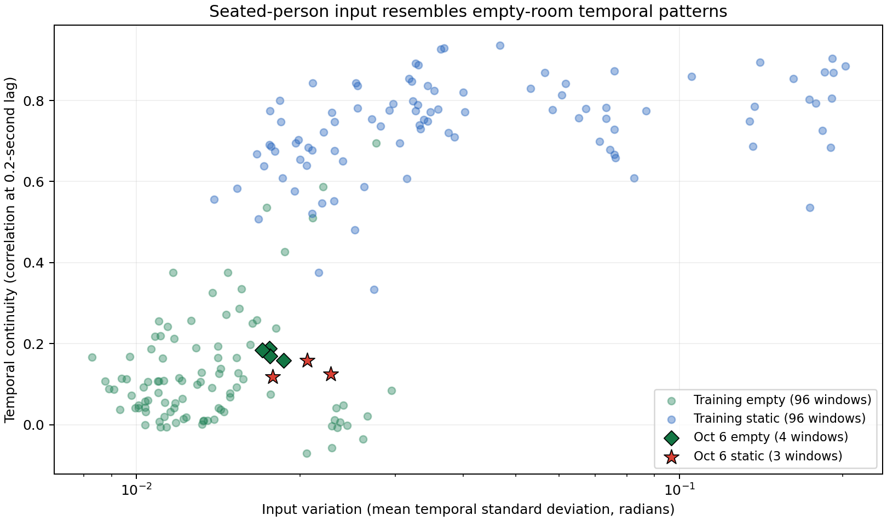

# 위상 모델이 앉아 있는 사람을 빈 방으로 판단한 원인 분석

> 상태: **SUPPORTING ANALYSIS — 모델의 오판 기전 확인, 물리적 환경 원인은 미확정**
> 분석일: 2026-10-08. [10/6 재생 비교](20261006-phase60-transition-replay.md)의 후속 진단.

1~4번의 용어와 실험을 예시로 풀어쓴 [쉬운 설명](20261008-phase60-static-diagnosis-easy.md)을 먼저 읽어도 된다.

## 무엇이 원인이었나

**모델은 정지한 사람이 있을 때의 ‘천천히 이어지는 신호 변화’를 중요한 단서로 사용한다.
이번 앉기 신호에는 그 패턴이 약해서 빈 방으로 분류했다.**
단순히 신호 크기가 작아서 생긴 문제라고 설명하기에는 부족하다.
크기가 비슷한 학습 정지 신호는 맞히지만, 이번 신호는 변화의 시간적 모양이 달랐다.

9/19·20의 학습 60세션, 9/16·17의 평가 15세션, 10/6 원본을 같은 전처리와
고정된 모델로 비교했다. 정지 자료는 학습 20세션·평가 5세션이다.
모델 파일·클래스 순서·원본 변환·예측 집계의 불일치는 발견하지 못했다.

단, **왜 이번 방에서는 그 패턴이 약한지**까지 물리적으로 확정한 것은 아니다.
장치·사람 위치, 전파 경로, 자세, 주변 환경의 영향을 분리할 기록·반복 실험은 없다.
느린 변화를 측정했다고 해서 그것을 곧바로 호흡이라고 부를 수도 없다.

## 1. 크기보다 시간 패턴의 차이가 뚜렷했다

각 60초 창에서 156개 입력 신호의 시간 변화량과 연속성을 계산했다.
아래는 창별 값의 중앙값이다. 기존 0.3초 재생 정확도를 다시 정의한 표가 아니다.

| 자료 | 확인한 60초 창 | 변화량 | 0.2초 전후 연속성 | 느린 변화 비중 |
|---|---:|---:|---:|---:|
| 학습 빈 방 | 96 | 0.0130 | 0.089 | 27.10% |
| 학습 정지 | 96 | 0.0331 | **0.754** | **74.67%** |
| 이번 빈 방 | 4 | 0.0176 | 0.176 | 32.71% |
| 이번 앉기 | 3 | 0.0206 | **0.124** | **30.86%** |

- **변화량**: 각 신호의 시간축 표준편차를 156신호에서 평균. 단위는 라디안이다.
- **연속성**: 0.2초 떨어진 입력값의 정규화된 내적. 1에 가까울수록 이웃 값이 비슷하게 이어진다.
- **느린 변화 비중**: 창 평균을 제거한 입력의 에너지 중 `0 < f ≤ 0.5Hz` 비중.
  5Hz 입력의 단측 FFT를 사용하고 DC·Nyquist를 구분해 Parseval 등식으로 검산했다.
  호흡 검출률이나 모델 정확도가 아니다.

학습 정지의 연속성 범위는 **0.334~0.936**, 이번 앉기는 **0.118~0.159**였다.
이번 앉기는 이 지표에서 학습 정지 96창 전체보다 낮았다.
반면 변화량은 서로 겹친다. 예를 들어 학습 s55·s56은 변화량 약 0.014~0.022로
이번 앉기와 비슷해도 9창 모두 정지로 맞혔다. 이때 연속성은 0.375~0.686이었다.



가로축은 변화량, 세로축은 시간 연속성이다. 빨간 별(이번 앉기)이 초록 빈 방 영역에 있다.
겹치지 않는 창을 썼어도 같은 세션의 창들은 독립된 사람·독립 실험이 아니다.

## 2. 시간 모양을 바꿔 모델 반응을 확인했다

원본이나 가중치를 바꾸지 않고, 메모리에 만든 **가상 진단 입력**을 모델에 넣었다.

| 진단 | 보존한 것 | 결과 |
|---|---|---|
| 이번 앉기의 변화량을 0.5~6배로 조정 | 시간 순서 | 3창 모두 어떤 배율에서도 정지가 되지 않음. 커지면 움직임으로 바뀜 |
| 과거 정지 입력의 시간 순서를 무작위로 섞음 | 각 신호의 값 분포·평균·표준편차 | 원래 정지를 맞힌 **14/14창이 빈 방**으로 바뀜 |
| 이번 입력을 시간상 부드럽게 만든 뒤 원래 표준편차로 복원 | 각 신호의 변화량 | 이번 앉기 **3/3창이 정지**로 바뀜 |
| 같은 처리를 이번 빈 방에도 적용 | 각 신호의 변화량 | 빈 방 **4/4창도 정지로 오판** |

시간 순서 실험은 9/20 s55·s56의 9창과 9/17 s39의 5창이다.
섞기에는 고정 난수 42를 사용했다. 부드럽게 만들기는 원형 경계의 3·5·11시점
이동 평균 후, 각 신호의 표준편차를 원래 값으로 맞췄다. 세 길이 모두 위 결과가 같다.

**시간 패턴이 판정에 영향을 준다는 증거다. 평활화를 추가하면 해결된다는 뜻은 아니다.**
빈 방까지 정지로 바뀌므로 그대로 도입할 수 없다. 가상 입력은 실제 사람이 있는 새 시험이 아니다.

## 3. 전처리·모델 구조가 갖는 한계

위상 모델은 각 60초 창에서 신호별 평균을 뺀다. 따라서 사람이 있어 생긴 변화 중
60초 내내 일정하게 유지되는 평균 차이는 입력에서 제거된다. CNN에는 남은 시간 변화가 들어간다.

이번 입력의 시간 변화는 빈 방과 비슷했고, 저장 모델은 그 입력을 빈 방으로 해석했다.
이것은 가져오는 과정의 코드 오류가 아니라 **현재 특징과 학습 모델의 일반화 실패**로 볼 근거가 있다.
평균 차감을 바로 삭제하면 학습 때 입력과 달라지므로, 저장 모델에 임의로 적용하는 해결책은 아니다.

## 4. 수집 문제와 학습 조건도 확인했다

- 학습·평가 75세션과 이번 시험은 RX 3대의 MAC·device ID·rx ID·SINK 식별자가 일치한다.
  과거에도 SINK 업링크를 사용했다. 이번에만 무선이라서 생긴 차이라고 설명할 근거는 없다.
- 검사한 raw의 채널 11·rate 코드 11·sig_len 47은 같다. 유효 톤의 I/Q 포화는 0이다.
  이번 정지에서 모든 입력이 0이거나 장치가 꺼진 현상은 없다.
- RX103의 6프레임 누락은 퇴실 뒤에 발생했다. 이번 정지 오판의 원인이 아니다.
- main의 특징·학습·구조 코드는 가져온 원본과 같다. 원본에서 별도로 계산한 위상 직선 제거와
  공식 계산의 차이는 검증한 창에서 최대 `8.9e-15`였다. NumPy matmul 경고는 여전히 있으나
  이 경고가 이번 오판을 만들었다는 증거는 없고 유효 입력·점수는 유한하다.
- 학습 메모에는 **서기·의자 앉기·바닥 앉기**가 모두 있다. 일부에는 휴대폰·작은 움직임도 적혀 있다.
  분석 중 한 세션의 ‘서 있음’을 확인했지만, 전체가 서 있는 자료라는 해석은 철회했다.
- 학습 메모의 장소는 **6m×7m 방 안의 3m×3m 측정 구역**이다. 이번은 사용자가 말한 개인 방이다.
  현재 capture에는 `session_meta_snapshot.yaml`이 없으며, registry 좌표·메모는 과거 값이 그대로다.
  같은 좌표 파일이 있다는 사실만으로 실제 배치가 같았다고 판단할 수 없다.

## 확인 범위와 다음 확인

**확인된 것:** 이번 전처리 입력의 시간 패턴이 학습 정지와 다르고 빈 방에 가깝다.
시간 패턴을 조작하면, 변화량을 유지해도 모델 출력이 바뀐다.

**아직 확정되지 않은 것:** 이 차이가 구체적으로 어느 장치 위치·사람 위치·자세·전파 경로 때문에
생겼는지, 원본에 있는 유용한 정지 정보가 다른 특징으로 회복 가능한지.

다음 시험은 같은 방·같은 장치 배치에서 빈 방, 같은 위치에서 서기, 의자 앉기를 교차 반복하고
사람 위치만 바꿔 비교하는 것이 원인을 분리하는 데 도움이 된다. 각 상태는 60초보다 길게
유지하고 완전히 멈춘 시각을 기록한다. 현재 모델은 평가용으로 고정한다.
이 추가 수집과 새 특징 실험·학습은 이번 진단에서 실행하지 않았다.

## 방법·결과 파일

과거 자료는 시작점 0에서 6,000프레임씩 이동하는 겹치지 않는 60초 창 중 유효 창을 썼다.
학습 290창, 평가 71창이다. 기존 3초 이동 세션 평가 결과와 별개의 진단 표본이다.
이번 시험은 사용자 행동 구간 안에 완전히 들어오는 60초 창을 사용했다.
빈 방 4·정지 3·걷기 2창이며 누락이 든 마지막 빈 방 첫 창은 제외했다.
앉기 첫 창은 앉기 시작 동작을 포함할 수 있고, 뒤의 두 창에서도 같은 문제가 나타났다.
시간 정렬은 기존 재생과 같은 근사 시각이다.

- [공유 요약 JSON](assets/20261008-phase60-static-diagnosis/summary.json)
- 전체 측정: `model_train/analysis/output/20261008-phase60-static-diagnosis-final/results.json`
- 가상 입력 진단: `model_train/analysis/output/20261008-phase60-temporal-probes-final/results.json`
- 원본·메타·모델·관련 코드 **540파일 해시 불변**, 모델 상태 불변.
- 공식 입력의 기존 점수와 다시 계산한 점수를 대조했고, 가상 입력의 신호별 표준편차 보존을 검사했다.

```bash
.venv/bin/python model_train/analysis/diagnose_phase60_static.py \
  --output model_train/analysis/output/<새-진단-폴더>
.venv/bin/python model_train/analysis/probe_phase60_temporal.py \
  --source model_train/analysis/output/<새-진단-폴더>/results.json \
  --output model_train/analysis/output/<새-가상입력-폴더>
```

초기 탐색 결과 폴더도 로컬에 보존했다. 위 `-final` 파일이 보고서의 정본이다.
모델 가중치·원본·GUI·CLI는 변경하지 않았다.
