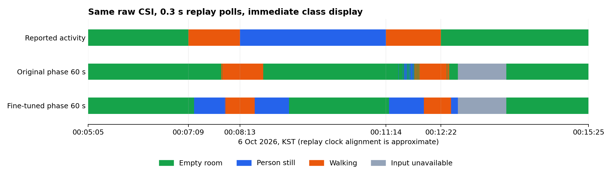

# 10월 6일 자료로 확인한 위상 파인튜닝 전후 결과

> 상태: **SUPPORTING ANALYSIS** — 고정 모델 비교 완료. 평가 중 추가 학습은 하지 않았다.
> 평가일: 2026-10-13. 모델은 [10/12 방 자료로 추가 학습한 위상 모델](20261013-phase60-room-finetuning.md)이다.

## 결론

**10/12 배치에 맞춰 학습한 모델은, 다른 배치였던 10/6 자료의 앉기 오판을 거의 해결하지 못했다.** 앉기 전체 181초의 정지 표시 일치율은 0%에서 23.54%로 올랐지만, 앉은 뒤 첫 60초를 제외하면 **121초 중 0.91초만 정지로 맞히고 나머지 120.09초는 빈 방으로 판단**했다. 완전히 앉기 구간 안에 들어가는 60초 창 34개도 두 모델 모두 빈 방으로 틀렸다.

전체 시간 일치율은 46.90%에서 49.66%로 조금 올랐지만, 두 걷기 구간의 일치율은 하락했고 퇴실 후 빈 방 첫 판정도 늦어졌다. 따라서 10/12 학습 자료의 100%를 다른 녹화에서의 안정적인 empty/static 구분으로 해석할 수 없다.

2026-10-13 사용자는 **10/6에는 RX별 위치가 10/12와 달랐고 삼각대를 사용하지 않았다**고 확인했다. 두 날짜의 배치 사진도 확인했다. 따라서 이번 결과는 **다른 배치·앉는 조건으로 구분 능력이 충분히 이어지지 않은 결과**다. 배치 차이가 오판의 유일한 원인인지, 학습 자료에만 맞춘 영향이 얼마나 있는지는 이 비교만으로 나눠 판단할 수 없다.

사용자의 서비스 목표는 새 방에서 짧게 안내 측정을 한 뒤 그 방에 맞춰 파인튜닝하고 사용하는 것이다. **이번 비교는 10/12와 같은 배치에서 새로 측정한 시험이 아니므로, 그 목표에 대한 파인튜닝 성공·실패를 확정하는 시험으로 해석하지 않는다.** 현재 모델을 고정하고 10/12 배치를 유지한 새 녹화에서 확인해야 한다.

## 두 측정의 배치 차이 — 사용자 확인과 사진 반영

| 조건 | 10/6 평가 자료 | 10/12 추가 학습 자료 |
|---|---|---|
| RX101·102·103 위치 | 10/12와 다름 — 사용자 확인 | 해당 날짜의 배치 사진 기준 |
| 삼각대 | 사용하지 않음 — 사용자 확인 | 사용 — 배치 사진 확인 |
| 앉아 있는 상태 | 의자 앉기 | 침대 앉기 |
| 사진 위치 | `/Users/jaehyeog/Desktop/10.6 실시간 측정/배치.png` | `/Users/jaehyeog/Desktop/10.12 실시간 측정/배치.jpeg` |

10/6 사진에는 낮은 테이블·침대 등 당시 배치가 보이고, 10/12 사진에는 RX1·RX2·RX3과 TX의 삼각대 배치가 보인다. 10/6 사진만으로 각 보드를 RX101·102·103에 개별 대응시키거나 정확한 좌표·높이를 산출하지 않았다. RX별 위치 차이와 삼각대 미사용은 사용자가 확인한 정보로 기록한다.

같은 방이어도 장치 위치·높이·방향이 달라지면 신호가 사람과 가구를 지나오는 경로가 달라질 수 있다. 이는 결과에 영향을 줄 수 있는 조건 차이이며, 이번 자료로 각각의 영향 크기를 측정한 것은 아니다. 두 배치 사진은 평가 후 추가 확인한 근거로 공유 요약 JSON에 별도 해시를 기록했다. 기존 평가 입력 18파일 검증 목록에 소급해서 포함하지 않는다.

## 어떤 자료와 모델을 비교했는가

- 원본: `mac_collector_output/realtime/20261005-235852-cba933f4/capture/`의 RX 3대 신호.
- 행동 시간표: 10/6 00:05:05~00:15:25, 총 620초. 기존 보고서의 시각과 정답 구간을 유지했다.
- 원래 위상: `model_train/phase60/model_60sessions.pt`.
- 추가 학습 위상: `model_train/phase60/model_room_20261012.pt`.
- 두 모델 모두 60초 입력·seed 3개 평균·0.3초 이동·최대 점수 클래스 즉시 표시다.
- **10/6 원본은 이번 파인튜닝에 쓰지 않았다.** 원본 CSI 파일 해시가 추가 학습 입력 목록에 없음을 확인했다.

다만 10/6은 이전에 재생·원인 분석으로 살펴본 자료다. 학습하지 않은 녹화 비교로는 사용할 수 있지만, 프로젝트에서 완전히 처음 보는 독립 시험이라고 부르지 않는다. 실제 보드를 새로 켠 시험이 아니라 저장 원본 재생이며 시간 정렬은 근사다.

## 행동별 결과

비율은 각 행동 구간에서 **판단 가능한 시간 중 올바른 클래스를 표시한 비율**이다. 판단 불가 시간은 따로 공개한다. 일반적인 창 정답률과 구분한다.

| 실제 행동 | 구간 길이 | 원래 위상 | 파인튜닝 위상 | 판단 불가: 두 모델 동일 |
|---|---:|---:|---:|---:|
| 첫 빈 방 | 124초 | 100% | 100% | 0초 |
| 첫 걷기 | 64초 | 35.61% | 28.57% | 0초 |
| 앉아서 정지 | 181초 | 0% | 23.54% | 0초 |
| 두 번째 걷기 | 68초 | 44.54% | 30.86% | 0초 |
| 마지막 빈 방 | 183초 | 92.43% | 82.92% | 60초 |

파인튜닝 모델은 앉기 전체에서 **정지 42.60초 / 빈 방 120.09초 / 움직임 18.31초**를 표시했다. 정지로 맞힌 대부분은 앉기 직후 첫 60초 안에 있다.

### 이전 행동이 입력에 섞이는 첫 60초를 제외하면

| 실제 행동 | 남은 길이 | 원래 위상 | 파인튜닝 위상 |
|---|---:|---:|---:|
| 첫 빈 방 | 64초 | 100% | 100% |
| 첫 걷기 | 4초 | 100% | 100% |
| 앉아서 정지 | 121초 | 0% | **0.75%** |
| 두 번째 걷기 | 8초 | 100% | 100% |
| 마지막 빈 방 | 123초 | 100% | 100% |

마지막 빈 방의 판단 불가 21.01초는 이 표의 분모에서도 제외하고, 전체 시간 집계에는 포함한다. 걷기의 남은 4초·8초는 짧으므로 일반적인 걷기 성능이 100%라고 주장하지 않는다.

### 안정 상태 내부의 60초 창도 따로 확인했다

행동 경계 양쪽 10초를 제외하고, 입력 60초 전체가 그 구간 안에 있는 창을 3초씩 이동해 확인했다. 원래/추가 학습 모델 모두 다음과 같다.

- 빈 방: **46/46** 정답.
- 정지: **0/34** 정답. 모두 빈 방으로 판정.
- 걷기: 경계 여유를 빼면 60초보다 짧아 평가할 창이 없다.

이 80창은 empty/static 진단용이며 세 클래스 전체 정확도 시험이 아니다. 같은 녹화의 겹치는 창들이고 별도의 독립 실험 80회도 아니다. 공유 JSON의 이 진단에서는 평가하지 못한 motion 점수는 null로 표시하고, 세 클래스 평균 점수는 보고하지 않는다.

## 전체 시간과 전환 반응

| 지표 | 원래 위상 | 파인튜닝 위상 |
|---|---:|---:|
| 정답 표시 시간 | 290.76초 | 307.86초 |
| 판단 불가 시간 | 60초 | 60초 |
| 유효 시간 560초 중 일치율 | 51.92% | 54.98% |
| **판단 불가 포함 620초 중 일치율** | **46.90%** | **49.66%** |

| 행동 시작 후 첫 정답 표시까지 | 원래 위상 | 파인튜닝 위상 |
|---|---:|---:|
| 첫 걷기 | 40.91초 | 45.41초 |
| 앉기 | 정지 판정 없음 | 18.31초, 이후 다시 오판 |
| 두 번째 걷기 | 35.01초 | 47.01초 |
| 퇴실 후 빈 방 | 6.91초 | 81.01초 |

퇴실 뒤 RX103의 6프레임 누락으로 두 모델 모두 60초 판단 불가였다. 81.01초에는 이 영향도 포함되므로 모델 계산 시간이라고 읽지 않는다. 추가 학습 모델은 그 공백 전에도 빈 방 첫 정답을 내지 못했다.

## 재생 그림



맨 위는 실제 행동, 가운데는 원래 모델, 아래는 파인튜닝 모델이다. 초록은 빈 방, 파랑은 정지, 주황은 걷기, 회색은 판단 불가다. 실제 정지인 긴 파란 구간 중 뒤쪽을 두 모델 모두 초록으로 표시하는 점을 확인할 수 있다.

## 계산과 검증

기존 [10/6 재생 방법](20261006-phase60-transition-replay.md)의 입력·시간표·누락 규칙을 재사용했다. 각 시점까지 도착했다고 가정한 송신 순번 prefix로 최신 공통 창을 정하고, 새 공통 입력 30프레임 대기와 보간 오른쪽 관측값의 미래 사용 제한을 적용했다.

완성 파일 재생도 함께 계산했다. 주요 결론은 같았다. 원래 모델의 전체 시간 일치율은 prefix 46.90%·완성 파일 46.75%, 추가 학습 모델은 둘 다 49.66%다. 정지 60초 이후 결과는 양쪽 방식에서 같다.

시간축을 ±1초 이동했을 때 유효 시간 일치율은 원래 51.39~52.46%, 추가 학습 54.44~55.51%였다. 앉기 전체 23.54% 결과도 유지됐다. ±1초는 민감도 확인이며 실제 시계 오차 상한이 아니다.

- 286,393프레임의 CRC·헤더·식별·RF 검사 통과. 재부팅·송신 순번 역행 없음.
- 두 모델의 CNN 가중치가 동일함을 확인해 특징 계산을 공유했다. 각각의 head 점수는 별도로 계산했다.
- 3,066개 고유 입력 창 계산. 원본 prefix 직접 변환 12지점 대조 통과.
- 모델별 단일 창 경로와 배치 경로 점수의 최대 차이 약 `1.19e-7`.
- 원래 모델의 기존 10/6 집계 결과를 재현했다.
- 원본·기존 기록·모델·관련 코드 18파일 해시와 모델 상태 불변.
- 별도 검산으로 **40개 구간 시간 집계·11,118개 seed 평균/클래스 선택** 확인.
- 새 특징 공유 검사 2개와 기존 재생 검사 6개 통과. 그림 렌더링도 확인했다.

학습·가중치 수정·새 보드 수집은 수행하지 않았다. 프레임별 호스트 도착 시각이 없으므로 당시 무선·USB·화면 지연을 복원한 결과는 아니다.

## 결과 파일과 재현

- [공유 요약 JSON](assets/20261013-room-on-oct6/summary.json).
- 로컬 전체 기록: `model_train/analysis/output/20261013-room-on-oct6/`의 JSONL·protocol·summary.
- 원래 모델 해시: `1232d156dc9c1c6dd07a3dbf29384200d0848abd319cd3c7a77f30bd2f5b4c42`.
- 추가 학습 모델 해시: `5224bb396460240a373db5f9bbcb6762cecba1eb8c3701bf7b3ba453f465e364`.

```bash
.venv/bin/python model_train/analysis/evaluate_room_on_oct6.py \
  --output model_train/analysis/output/20261013-room-on-oct6-new-run
.venv/bin/python model_train/analysis/verify_transition_replay.py \
  --input model_train/analysis/output/20261013-room-on-oct6-new-run
```

현재 후보의 같은 배치에서의 개선 여부는 미확인이다. 다음 실제 시험은 학습 때의 침대 위치·장치 배치를 유지한 새 녹화에서 확인한다. 새 방으로 옮기거나 배치를 바꿨을 때는 그 조건에서 짧게 다시 측정·학습하는 서비스 흐름을 시험한다. 한 배치에서 학습한 모델이 다른 배치에서도 그대로 통하는지는 별도의 성능 항목으로 다룬다.
