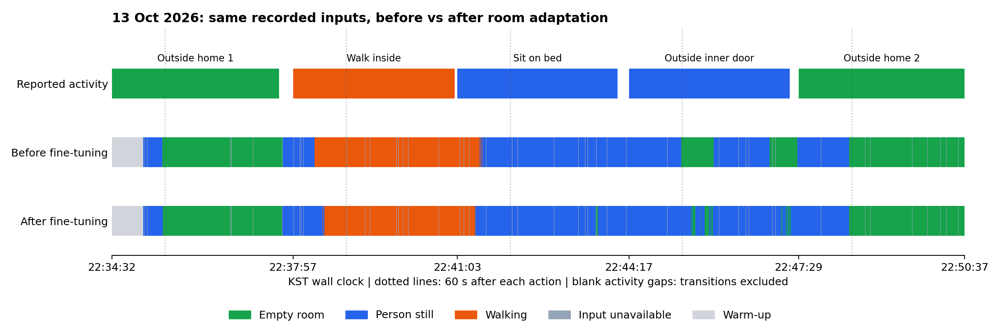

# 10월 13일 새 실시간 자료의 위상 파인튜닝 전후 평가

> 상태: **SUPPORTING ANALYSIS** — 2026-10-14 평가 완료. 새 녹화와 고정된 두 모델을 비교했다.

> 정답 기준 수정: 사용자가 감지 범위에 중문 밖 대기 공간도 포함한다고 확인했다.
> 따라서 해당 구간은 static으로 재집계한다. 최초 empty 평가는 경계를 잘못 가정한 결과다.
> 원본과 예측은 유지하며 평가 정답만 수정한다. 이는 이번 평가 범위의 정의이며 집 전체 감지 성능을 보장하지 않는다.

## 먼저 결론

수정된 감지 범위 기준에서 이번 녹화는 **파인튜닝 후 모델이 전체적으로 더 나았다.**
행동을 바꾸고 60초가 지난 뒤에는 두 모델 모두 집 밖 대기와 걷기를 잘 구분했다.
침대에 앉은 사람도 기존 모델은 이미 잘 구분했다. **중문 바로 밖에 가만히 서 있는 사람은
감지 범위 안의 static**이며, 이 구간의 일치율이 추가 학습 후 높아졌다.
이번 녹화에서는 개선됐지만 한 번의 시험으로 일반 성능을 확정하지 않는다.

## 자료와 정답

원본은 `mac_collector_output/realtime/20261013-223405-12476623/`이다.
사용자가 제공한 Desktop의 `20261013-223405-실시간 측정/info.txt`를 정답 시각으로 사용한다.
휴대전화와 Mac 시계가 같다는 사용자 기록에 따라 시차 0초를 적용한다.
문 여닫기·이동·착석 과정처럼 아래 표에 포함되지 않은 시간은 정확도 집계에서 제외한다.

| 조건 | 정답 | 시작 | 종료 |
|---|---|---|---|
| 집 밖 대기 1 | empty | 22:34:32 | 22:37:41 |
| 방 안 걷기 | motion | 22:37:57 | 22:41:00 |
| 침대에 앉아 정지 | static | 22:41:03 | 22:44:04 |
| 중문 바로 밖 대기 | static | 22:44:17 | 22:47:19 |
| 집 밖 대기 2 | empty | 22:47:29 | 22:50:37 |

사용자가 정의한 감지 범위에는 중문 밖 대기 위치도 포함된다. 따라서 중문 밖 정지는 static,
집 밖으로 완전히 나간 대기는 empty다. 이 정의는 모델 출력이 아니라 사용자 요청에 따른다.
집 밖 대기와 중문 밖 대기는 조건별로 나누어 보고한다.

## 평가 방법

- 파인튜닝 전 `model_60sessions.pt`와 후 `model_room_20261012.pt`를 고정한다.
- 실시간 판정 로그의 송신 순번으로 당시 사용한 60초 입력을 복원한다.
  두 모델은 같은 입력·판정 시각·수신 공백을 사용한다. 학습이나 가중치 선택에는 사용하지 않는다.
- 파인튜닝 후 모델을 다시 계산한 확률·클래스가 당시 로그와 일치하는지 확인한다.
  파인튜닝 전 모델은 동일한 시점에 같은 입력을 받았다고 가정한 비교이며 실제 온라인 실행 기록은 아니다.
- 실제 행동 시간 중 올바른 상태로 판정한 시간의 비율을 계산한다.
  판단 불가 포함 비율과 판단 가능한 시간만의 비율을 함께 보고한다.
- 각 행동 시작 후 첫 60초를 제외한 결과도 따로 계산한다.
  시각 기록은 초 단위이고 처리 지연이 있으므로 입력이 상태 경계 안에 완전히 들어간다는 엄밀한 증명은 아니다.
- 원본 CRC·장치 매핑·송신 순번·재부팅·RF 설정을 확인한다.
  새 녹화의 원본 해시가 추가 학습 입력에 포함되지 않았는지 확인한다.
- 전환 시간과 준비 시간은 안정 상태 성능과 구분한다. 이 한 녹화로 다른 방의 일반 정확도를 주장하지 않는다.

## 결과

### 행동 시작 후 첫 60초를 제외한 비교

60초 입력에 직전 행동이 섞이는 영향을 줄이기 위한 비교다.
아래 비율은 **판단 가능한 시간 중 정답을 표시한 시간의 비율**이며,
독립된 세션이나 서로 겹치지 않는 입력 창의 정확도가 아니다.

| 실제 행동 | 파인튜닝 전 | 파인튜닝 후 | 판단 불가 시간 |
|---|---:|---:|---:|
| 집 밖 대기 1 → 빈 방 | 100.00% | 100.00% | 1.98초 |
| 방 안 걷기 → 움직임 | 100.00% | 100.00% | 3.99초 |
| 침대에 앉기 → 정지 | 100.00% | 98.70% | 4.00초 |
| 중문 바로 밖 대기 → 정지 | 51.58% | 87.34% | 2.40초 |
| 집 밖 대기 2 → 빈 방 | 100.00% | 100.00% | 2.81초 |
| 합계 | **90.47%** | **97.26%** | **15.18초** |

총 623초 중 판단 가능한 607.82초를 분모로 계산했다. 판단 불가도 실패로 포함하면
전체 623초 기준으로는 **88.27% → 94.89%**다. 합계는 행별 비율의 단순 평균이 아니다.
중문 밖 대기의 판단 가능한 119.60초 중, 추가 학습 모델은 104.46초를 정답인 static으로 표시했다.
침대 앉기에서는 추가 학습 모델이 1.53초를 empty로 표시했다.

### 첫 60초도 포함한 비교

| 실제 행동 | 파인튜닝 전 | 파인튜닝 후 |
|---|---:|---:|
| 집 밖 대기 1 | 86.09% | 85.83% |
| 방 안 걷기 | 87.10% | 81.26% |
| 침대에 앉기 | 85.51% | 88.51% |
| 중문 바로 밖 대기 | 67.11% | 91.53% |
| 집 밖 대기 2 | 69.21% | 69.21% |
| 합계 | **78.67%** | **83.07%** |

정답이 지정된 923초 중 판단 가능한 866.90초 기준이다. 준비·수신 공백 등 56.10초를
실패로 포함한 전체 시간 기준은 **73.89% → 78.02%**다.
시각을 일괄 ±1초 옮겼을 때 판단 가능한 시간 기준 합계는 기존 78.45~78.89%,
추가 학습 82.79~83.34%였다. 이는 시각 오차의 측정값이나 보장 범위가 아니다.



위에서부터 실제 행동, 기존 모델, 추가 학습 모델이다. 초록은 빈 방, 파랑은 정지한 사람,
주황은 움직임이다. 회색은 준비 또는 판단 불가, 점선은 각 행동 시작 60초 뒤다.
실제 행동 행의 빈틈은 평가에서 제외한 이동·문 여닫기 시간이다.

## 입력과 계산 검증

- 수신 프레임 총 289,380개. RX101 95,220개, RX102 97,575개, RX103 96,585개다.
  CRC·헤더·장치 대응·RF 설정을 검사했고 재부팅·송신 순번 역행은 없었다.
- 중복은 기존 규칙대로 첫 프레임을 사용했다. 최대 연속 누락은 RX별 4·2·3개였다.
  실제 온라인 판단 불가 구간은 오프라인 보간 가능 여부와 별개로 그대로 유지했다.
- 실시간 로그 2,578행 중 새 추론 2,314개를 동일 입력으로 다시 계산했다.
  추가 학습 모델의 클래스는 당시 로그와 **100% 일치**, 확률 최대 차이는 **5.37e-7 미만**이다.
- 실제 prefix 입력 12개 대조, 두 모델의 단일/배치 계산 대조(최대 차이 5.97e-8 미만),
  별도 시간 집계 20개 검사와 관련 자동 테스트 4개가 통과했다.
- 새 원본이 추가 학습 입력에 없음을 해시로 확인했다. 입력·모델 등 21파일의 해시가
  실행 전후 동일했다. 추가 학습, 모델 교체, 원본 수정은 하지 않았다.

## 해석 범위와 다음 판단

한 사람·한 방·한 번의 녹화다. 이번 100%를 일반 정확도로 주장하지 않는다.
제공된 배치 사진은 10/12 사진과 파일 해시가 같아 배치 참고로 사용했으며,
측정 당시 위치가 정확히 같았음을 새 사진으로 독립 확인한 것은 아니다.
동영상은 이번 정답 판독에 사용하지 않았고 사용자 info.txt의 시각을 기준으로 했다.

집 밖 대기와 중문 바로 밖 대기의 차이는 관찰됐지만, 이 한 번의 결과만으로
원인을 문밖 사람의 신호 영향 하나로 확정할 수는 없다. 최초에는 중문을 감지 범위의
경계로 잘못 가정했다. 사용자의 범위 확인 후 static으로 정정했으며 구간을 제외하지 않았다.
수정 전 평가 산출물은 로컬에 보존했다. 고정된 예측을 재집계했으며 모델을 다시 학습하거나
추론하지 않았다. 이 수정은 범위 정의의 정정이지 모델 자체의 성능 변화가 아니다.
이번 결과는 추가 학습 모델에 유리하지만, 앞으로 같은 감지 범위를 미리 정한 별도 시험으로
반복 확인해야 한다. GUI 선택과 가중치는 변경하지 않았다.
이 녹화를 나중에 학습에 사용한다면 더 이상 독립 시험 자료로 재사용할 수 없다.

## 산출물과 재현

- [공유용 계산 결과 JSON](assets/20261013-room-live/summary.json)
- 수정 후 로컬 상세 출력: `model_train/analysis/output/20261014-room-live-223405-scope-corrected/`
- 최초 평가·추론 검증 원본: `model_train/analysis/output/20261014-room-live-223405/`
- 정정 시 고정된 판정 로그를 재사용해 시간 집계 20개를 다시 검산했다. 공유 JSON의 `protocol.label_correction`에 수정 이력을 남겼다.
- 평가 코드: `model_train/analysis/evaluate_room_live.py`
- 기존 가중치: `model_train/phase60/model_60sessions.pt`
- 추가 학습 가중치: `model_train/phase60/model_room_20261012.pt`

저장소 루트에서 다음과 같이 실행한다. `--info`에는 실제 Desktop 파일 경로를 넣는다.
새 출력 폴더를 사용해 기존 평가 산출물을 보존한다.

```bash
.venv/bin/python model_train/analysis/evaluate_room_live.py \
  --info '/Users/jaehyeog/Desktop/20261013-223405-실시간 측정/info.txt' \
  --output model_train/analysis/output/20261014-room-live-223405-rerun
```
