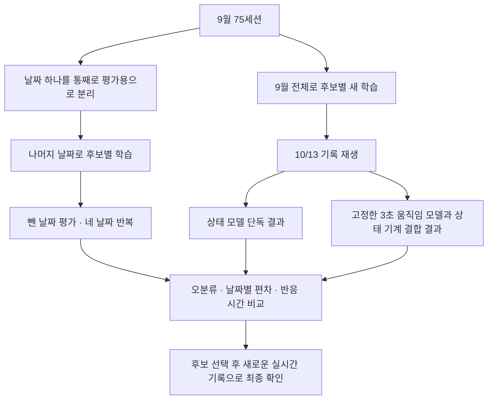

# 75세션으로 모델 구조를 비교하는 실험 설계

> 상태: **PLANNED** — 2026-10-31. 설계 단계이며 구현·학습·평가는 아직 시작하지 않았다.

## 1. 무엇을 알아볼 것인가

같은 진폭 신호를 줬을 때 공유 CNN, 일반 CNN, GRU, LSTM, Transformer,
Random Forest 중 어떤 구조가 empty·static·motion을 가장 안정적으로 구분하는지 비교한다.
앞선 실험은 진폭·위상과 창 길이를 비교했고, 이번에는 **입력을 고정하고 구조를 비교**한다.

평가는 두 종류다.

1. **날짜별 평가:** 한 날짜 전체를 학습에서 빼고 그 날짜를 맞히는지 확인한다. 날짜를 바꿔 네 번 반복한다.
2. **10/13 기록 평가:** 9월 전체 자료로 새로 학습한 각 후보를 실제 상태 전환 기록에 적용한다.

10/13은 이미 여러 후보 결과를 확인한 개발용 평가 자료다. 최종 모델을 선택한 뒤 새로 수집할
기록을 독립 최종 시험으로 사용한다. 이번 단계에서 새 방 적응용 파인튜닝까지 비교하지는 않는다.

## 2. 사용할 자료와 s12 처리

- 2026년 9/16 7세션, 9/17 8세션, 9/19 30세션, 9/20 30세션: 총 75세션.
- 라벨은 원본 session.json의 empty·static·motion을 사용한다.
- 9/19 s12는 기존 제외 규칙을 유지하여 모든 후보의 학습·내부 검증에서 제외한다.
- 날짜별 외부 평가는 s12를 포함한 75세션 결과와 제외한 74세션 결과를 함께 낸다.
  주 비교표는 기존 실험과 같은 74세션 기준이며, 75세션 결과도 바로 옆에 표시한다.
- s12의 제외는 기존 실험 조건을 유지하기 위한 결정이다. 라벨 오류가 확정됐다는 뜻은 아니다.
- 10/13은 `20261013-223405-12476623` 기록 하나를 사용한다. 삼각대 없이 측정한 10/6은 제외한다.

## 3. 입력을 어떻게 같게 만들 것인가

| 항목 | 이번 실험의 고정 조건 |
|---|---|
| 신호 | RX101·102·103에서 각각 17개, 총 51개 진폭 신호 |
| 창 길이 | 15초 |
| 시간 정렬 | TX 순번 기준 100Hz, 세 RX의 공통 끝점 |
| 상대 진폭 | 기존 진폭 전처리와 동일한 창 내부 평균 기준 변환 |
| 시간 축소 | 10개 시간값 평균 → 10Hz, 15초당 150시점 |
| 모델 공통 입력 | 한 창당 150시점 × 51신호 |
| 학습 창 간격 | 15초 |
| 날짜별 평가 창 간격 | 3초 |
| 10/13 재생 간격 | 0.3초 |
| 최초 창 | 유효한 15초가 찬 시점부터 사용 |

기존 전처리의 수식·서브캐리어 순서·결측 허용량·보간·클리핑을 재사용하고 버전과 해시를 저장한다.
후보마다 다른 유효 창을 사용하지 않도록 공통 창 목록을 먼저 만든다.
실시간 재생에서는 그 시점까지 도착한 자료만 사용하며 창 바깥 미래 값으로 보간하지 않는다.

앞선 15/30/60초 비교는 공통 시작점을 60초로 맞췄다. 이번에는 모두 15초이므로 15초부터 사용한다.
따라서 과거 점수와 직접 순위를 합치지 않고, 공유 CNN도 같은 조건으로 다시 학습한다.
추가 표준화가 필요한 후보는 학습 자료로만 평균·표준편차를 계산한다.

## 4. 비교할 여섯 후보

아래 크기는 구현할 기본안이다. 실행 전 입출력 크기·파라미터 수를 확인하고 설정 파일로 확정한다.
외부 평가 점수를 본 뒤 구조를 수정하면 별도 후속 실험으로 기록한다.

| 후보 | 입력 처리와 제안 구조 | 비교하는 차이 |
|---|---|---|
| 현재 공유 CNN | 신호마다 같은 CNN 적용 → 시간 평균·표준편차 → 신호 평균·표준편차·최대 → 분류 | 현재 방식의 기준선 |
| 일반 1D-CNN | 51채널을 함께 입력, Conv 51→32→64→64, 커널 5·5·3, stride 1, padding 2·2·1, 각 Conv 뒤 BN·ReLU, 앞 두 블록 뒤 평균풀링 2 → 시간 평균·표준편차 128 → Linear 32 → 3 | 신호 사이 관계를 처음부터 함께 학습 |
| GRU | 각 시점 51값 → 2층 단방향 GRU, hidden 64 → 마지막 층의 전체 시점 출력 평균·표준편차 128 → Linear 32 → 3 | 시간 순서를 기억하는 방식 |
| LSTM | GRU와 같은 입력·층수·hidden·시간 요약·분류층, 순환 셀만 LSTM | 다른 기억 구조 |
| 작은 Transformer | Linear 51→64 + 위치 정보 → encoder 2층, head 4, feedforward 128 → 시간 평균·표준편차 128 → Linear 32 → 3 | 창 안에서 떨어진 시점 사이 관계 |
| Random Forest | 각 신호의 평균·표준편차·최소·최대·연속 시점 차이 절댓값 평균: 51×5=255특징 → 트리 분류 | 신경망 없이 요약 통계만으로 가능한 수준 |

새 신경망의 Linear 32 뒤 ReLU·dropout 0.3을 사용한다. GRU/LSTM 층 사이와 Transformer dropout은 0.1이다.
공유 CNN은 기존 구조를 그대로 기준으로 쓴다. 모든 후보가 창 하나에서 확률 3개를 출력한다.
Random Forest도 같은 전처리 창을 요약하며, 특징 추출 시간까지 추론 시간에 포함한다.
모델 크기는 정확히 같지 않으므로 파라미터 수·파일 크기·처리 시간을 함께 공개한다.

## 5. 평가 ①: 한 날짜를 빼고 평가

| 회차 | 학습에 사용할 날짜 | 외부 평가 날짜 | s12 제외 후 학습 세션 수 |
|---|---|---|---:|
| 1 | 9/17·19·20 | 9/16 | 67 |
| 2 | 9/16·19·20 | 9/17 | 66 |
| 3 | 9/16·17·20 | 9/19 | 45 |
| 4 | 9/16·17·19 | 9/20 | 44 |

**외부 평가 날짜는 학습 종료 시점이나 설정을 고르는 데 사용하지 않는다.**
학습 날짜 안에서 별도로 일부 세션을 내부 검증용으로 나눈다.

예: 9/16을 평가할 때, 9/17·19·20의 67세션 안에서 약 20%를 내부 검증으로 떼어
학습 횟수를 정한다. 이후 67세션 전체로 처음부터 다시 학습하고, 마지막에 9/16을 평가한다.
내부 검증은 학습 방법을 정하는 자료이고, 외부 평가는 그 방법의 성능을 확인하는 자료다.

- 내부 검증 세션은 날짜·클래스가 가능한 한 고르게 포함되도록 고정한다.
  모든 후보·seed가 같은 내부 분할을 사용하고 실제 세션 ID 목록을 저장한다.
- 한 세션의 창은 한 역할에만 배정한다. 겹치는 창을 무작위로 나눠 양쪽에 넣지 않는다.
- 신경망: seed 0·1·2, AdamW, lr 0.001, weight decay 0.01, batch 32,
  label smoothing 0.1, 최대 60 epoch. 이번 구조 비교에서는 별도 데이터 증강을 적용하지 않는다.
- 각 seed에서 내부 검증의 세션 균등 macro F1이 가장 높은 epoch를 선택한다. 동률이면 이른 epoch.
  학습 전체로 재학습할 때는 초기화부터 그 epoch 수만큼 학습한다.
- Random Forest: 500 trees, max_depth 12, min_samples_leaf 5,
  max_features sqrt, class_weight balanced, seed 0·1·2. epoch 선택 없이 학습 전체로 적합한다.
- 신경망별 최적 epoch·학습/검증 곡선을 공개한다. 60 epoch에서도 개선 중인 후보는
  충분히 학습됐다고 단정하지 않고 한계를 표시한다. 이번은 고정 기본 설정의 비교다.

주 결과는 seed 3개의 **확률을 평균한 뒤** 판정한다. 각 seed의 점수와 편차도 함께 표시한다.
신경망 5종은 날짜별 내부 학습·재학습 120회, RF는 날짜별 12회 적합이 예정된다.

## 6. 평가 ②: 10/13 실제 상태 전환 기록

각 후보는 9월 74세션 안에서 위와 같은 내부 검증으로 학습 횟수를 결정한 뒤,
74세션 전체로 다시 학습한다. 신경망은 내부 학습·재학습 30회, RF는 3회 적합이 추가된다.
날짜별 평가에 쓴 네 모델을 단순히 합쳐 사용하는 방식이 아니다.
10/13 자료는 가중치 학습·학습 종료 선택에 넣지 않는다.

정답 구간과 시간축은 [기존 재생 평가 계획](pilot-live-comparison-plan.md)을 그대로 따른다.
집 밖 empty, 걷기 motion, 침대 static, **중문 밖 static**을 유지한다.
정답이 없는 이동 구간은 채점에서 제외하되 그 사이에도 재생과 상태 기계는 계속 동작한다.

각 후보에 대해 두 결과를 낸다.

1. **상태 모델 단독:** 매 0.3초의 세 클래스 확률 중 가장 큰 클래스로 판정.
2. **최종 표시:** 고정한 진폭 3초 움직임 모델과 현재 상태 기계를 결합한 판정.

3초 모델 가중치·임계값·상태 유지 시간을 모든 후보에서 동일하게 고정하고 해시를 기록한다.
현재 배포 중인 15초 모델도 별도 참고 행으로 평가한다. 구조 비교의 정식 기준선은 이번에 재학습한 공유 CNN이다.

원본에 프레임별 호스트 수신 시간이 없으므로 TX 순번 기반 재생이며, 실제 USB·GUI 지연의 완전 재현은 아니다.
기록 시각 ±1초 민감도와 입력 무효·이전 표시 유지 비율도 보고한다.

## 7. 무엇으로 비교하고 선택할 것인가

| 평가 | 반드시 보여줄 결과 |
|---|---|
| 날짜별 | 날짜별 macro F1·정확도, 클래스별 재현율, 혼동행렬, empty→static 및 static→empty 비율 |
| 통합 | 날짜별 점수의 단순 평균, 가장 나쁜 날짜의 점수, seed별 편차, s12 포함/제외 결과 |
| 세션 판정 | 해당 세션의 모든 유효 창 확률 평균 → 가장 큰 클래스, 맞힌 세션 수/평가 세션 수 |
| 10/13 | 전체 정답 923초 일치율, 클래스별 일치율, 첫 60초를 뺀 공통 623초 일치율 |
| 전환 | 첫 정답 표시까지 걸린 시간, 정답을 10초 연속 유지하기 시작한 시각까지의 시간 |
| 처리 비용 | 같은 장치에서 batch 1 및 3-seed 전체 추론의 중앙값·95백분위 시간, 파일 크기 |

macro F1은 세 클래스 각각의 오탐·놓침을 함께 반영한 점수의 평균이다.
큰 날짜가 결과를 지배하지 않도록 먼저 각 세션 창의 총 가중치를 같게 해 날짜별 지표를 계산하고,
그 날짜별 점수를 네 날짜에 같은 비중으로 평균한다. 세션 전체 판정 정확도와 창 지표는 따로 표기한다.

입력이 무효한 시간을 제외한 정확도와 전체 정답 시간을 분모로 한 일치율을 함께 표시한다.
10초 유지에 끝내 도달하지 않으면 실패로 남긴다. 이미 맞는 상태였던 구간의 0초는 즉시 감지 증거로 보지 않는다.

선택은 날짜 평균 macro F1을 중심으로 하되, 최악 날짜와 empty/static 오분류, 실시간 전환 실패·지연을 함께 본다.
날짜 평균 차이가 0.01 이내이면 실용적인 근접 후보로 두고 속도·안정성으로 판단한다.
이 0.01은 통계적 유의성 기준이 아니다. 겹치는 창 수를 독립 표본 수로 사용하지 않는다.
네 날짜의 사람·배치 차이가 얽혀 있어 날짜 평가만으로 새로운 사람·방에 대한 성능을 확정하지 않는다.

날짜별 평가는 **상태 모델 단독**으로 한다. 고정 3초 모델이 일부 9월 평가 자료를 학습했으므로,
이를 날짜별 평가에 결합하면 학습하지 않은 날짜라는 조건을 지킬 수 없기 때문이다.

## 8. 구현 시 남길 산출물과 검증

별도 실험 폴더에 설정, 코드 버전, 원본 해시, 세션 분할, 유효 창 목록,
seed별 체크포인트, epoch 선택 근거, 창별 확률, 세션별 점수, 10/13 타임라인을 저장한다.
계획 경로는 `model_train/architecture_pilot/`이며 아직 생성하지 않았다.
결과 문서는 이 문서 옆 `architecture-comparison-report.md`로 작성할 예정이다.

구현 시 확인할 사항:

- 학습·내부 검증·외부 평가의 세션 중복이 없고 s12가 학습에 들어가지 않는가.
- 모든 후보의 창 목록·라벨·클래스 순서가 일치하는가.
- 전처리 및 모델 입력이 현재 진폭 경로와 일치하는가.
- 저장 모델을 다시 읽어도 같은 확률이 나오는가.
- 재생이 미래 프레임을 사용하지 않고 현재 상태 기계와 같은 결합 결과를 내는가.
- 모델 단독과 최종 표시 점수, 유효 추론과 과거 표시 유지가 구분되는가.

## 9. 진행 순서

- [x] 후보·공통 입력·두 평가 방법을 설계 문서로 정리.
- [ ] 공통 분할과 창 목록, 모델 여섯 종류를 구현하고 작은 실행으로 검증.
- [ ] 날짜별 학습·평가를 완료하고 학습 곡선과 오분류를 점검.
- [ ] 74세션 전체 학습 후 10/13 단독·결합 재생 평가.
- [ ] 결과 보고서와 후보 선택 근거 작성.
- [ ] 선택한 후보로 새로운 실시간 기록 수집·최종 확인 계획 수립.

위상 입력과 30·60초 창 확장은 이 결과를 본 뒤 별도 후속 실험으로 설계한다.

관련 기록: [이전 입력·창 길이 비교](pilot-75-session-report.md),
[이전 10/13 비교](pilot-live-comparison-report.md).
