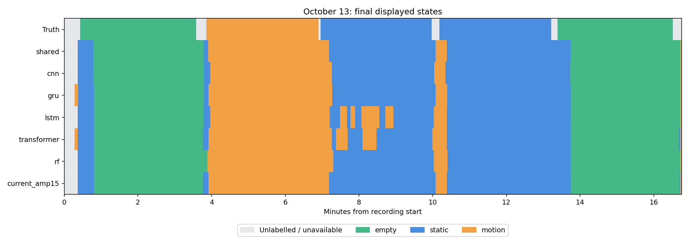

# 75세션 모델 구조 비교 결과

> 상태: **SUPPORTING ANALYSIS** — 2026-11-02. 날짜별 평가와 10/13 기록 재생.

[설계](architecture-comparison-plan.md)의 진폭 15초 공통 입력·내부 검증 후 재학습 조건을 적용했다.
s12는 모든 학습에서 제외했다. 학습 창 15초, 날짜별 평가 창 3초, 실시간 재생 0.3초 간격이다.

## 날짜별 평가

날짜 평균 F1은 세션별 창 비중을 같게 계산한 날짜별 macro F1의 단순 평균이다. 세션 정확도와 구분한다.

| 모델 | 74세션 날짜 평균 F1 | 75세션 날짜 평균 F1 | 최악 날짜 F1 | 세션 정답/74 | seed 편차 |
|---|---:|---:|---:|---:|---:|
| 공유 CNN | 0.8233 | 0.8200 | 0.6693 | 69/74 | 0.0024 |
| Random Forest | 0.8085 | 0.8012 | 0.7121 | 67/74 | 0.0028 |
| GRU | 0.8083 | 0.8016 | 0.6662 | 68/74 | 0.0191 |
| Transformer | 0.7734 | 0.7667 | 0.7008 | 65/74 | 0.0089 |
| LSTM | 0.7604 | 0.7541 | 0.6299 | 63/74 | 0.0244 |
| 일반 1D-CNN | 0.7515 | 0.7470 | 0.5227 | 62/74 | 0.0090 |

## 10/13 기록 재생

| 모델 | 전체 923초 최종 표시 일치율 | 안정 623초 일치율 | 단독 유효시간 일치율 |
|---|---:|---:|---:|
| 공유 CNN | 92.0% | 100.0% | 95.6% |
| 일반 1D-CNN | 91.6% | 100.0% | 94.9% |
| GRU | 91.3% | 100.0% | 95.1% |
| LSTM | 84.8% | 93.2% | 91.9% |
| Transformer | 86.9% | 96.3% | 89.8% |
| Random Forest | 91.3% | 100.0% | 94.8% |
| 현재 배포 모델 | 92.0% | 100.0% | 95.3% |

## 날짜별 점수와 선택한 학습 횟수

| 모델 | 9/16 F1 | 9/17 F1 | 9/19 F1 | 9/20 F1 | 전체 재학습 epoch (seed 0·1·2) |
|---|---:|---:|---:|---:|---|
| 공유 CNN | 0.7224 | 0.6693 | 0.9579 | 0.9435 | 40, 55, 59 |
| Random Forest | 0.7709 | 0.7121 | 0.9158 | 0.8354 | 해당 없음 |
| GRU | 0.7735 | 0.6662 | 0.9177 | 0.8760 | 33, 14, 19 |
| Transformer | 0.7234 | 0.7008 | 0.8388 | 0.8306 | 18, 7, 20 |
| LSTM | 0.7610 | 0.6299 | 0.8526 | 0.7980 | 34, 26, 16 |
| 일반 1D-CNN | 0.7560 | 0.5227 | 0.9054 | 0.8219 | 9, 3, 3 |

## 실시간 클래스별 일치율과 전환

| 모델 | empty | static | motion | 집 밖 1 안정 판정까지 | 집 밖 2 안정 판정까지 |
|---|---:|---:|---:|---:|---:|
| 공유 CNN | 88.4% | 92.7% | 98.1% | 21.9초 | 21.6초 |
| 일반 1D-CNN | 88.8% | 92.2% | 96.4% | 21.3초 | 21.0초 |
| GRU | 88.1% | 91.3% | 97.7% | 22.5초 | 22.2초 |
| LSTM | 88.2% | 75.5% | 96.4% | 22.2초 | 22.2초 |
| Transformer | 88.3% | 80.0% | 97.7% | 22.5초 | 21.6초 |
| Random Forest | 88.4% | 90.6% | 98.9% | 22.2초 | 21.6초 |
| 현재 배포 모델 | 88.3% | 92.9% | 97.7% | 22.2초 | 21.9초 |

## 처리 시간

CPU 2스레드에서 같은 입력 하나를 100회 측정했다. 모델 입력 준비 이후의 시간이며 RF 통계 추출은 포함한다.

| 모델 | 단일 seed 중앙값/p95 ms | 3-seed 중앙값/p95 ms | 파일 MB |
|---|---:|---:|---:|
| 공유 CNN | 2.47/2.61 | 7.41/7.53 | 0.08 |
| 일반 1D-CNN | 0.18/0.19 | 0.51/0.56 | 0.45 |
| GRU | 1.52/1.56 | 4.54/4.62 | 0.64 |
| LSTM | 1.55/1.59 | 4.66/4.73 | 0.82 |
| Transformer | 0.46/0.47 | 1.37/1.39 | 1.04 |
| Random Forest | 25.16/26.11 | 75.01/77.49 | 11.00 |



## 해석 범위

- 고정된 기본 설정의 비교다. 모든 구조의 최적 성능을 찾았다는 의미는 아니다.
- 10/13은 반복 사용한 개발용 기록이다. 독립 시험은 모델 선택 후 새 수집으로 진행한다.
- TX 순번 기반 재생이므로 실제 USB·GUI 도착 지연 전체를 재현하지 않는다.
- 날짜별 클래스 혼동·회차별 결과·전환 지연·±1초 민감도는 [전체 결과](assets/architecture/results.json)에 보존했다.
- [학습 기록](assets/architecture/training.json)에 선택 epoch, 학습 곡선, 재로딩 오차를 보존했다.
- 가중치·캐시·각 시점의 확률은 로컬 `model_train/architecture_pilot/runs/20261102/`에 있다.

## 판단과 다음 작업

이번 진폭 15초 조건에서는 공유 CNN을 우선 유지한다. 날짜 평균 F1과 10/13 최종 표시에서 가장 높지만, 현재 배포 모델 대비 실시간 개선은 거의 없다. 기존 GUI 가중치를 교체할 근거는 부족하다.
Random Forest는 가장 나쁜 날짜의 F1이 공유 CNN보다 높았다. 날짜 변화에 대한 보조 비교 후보로 남긴다. GRU는 평균 점수가 비슷하지만 seed 편차가 더 크다.
LSTM과 Transformer는 10/13 침대 static 구간에서 motion으로 바뀌는 오판이 남았다. 복잡한 구조를 쓰는 것만으로 해결되지 않았다.
공유 CNN도 9/16·17 점수가 9/19·20보다 낮다. 사람·배치·날짜 조건 변화가 남은 문제이며, 새 방 성능이나 파인튜닝 효과를 이 실험만으로 단정하지 않는다.

다음 독립 시험은 현재 공유 CNN 구성을 먼저 고정한 뒤, 같은 장치 배치·문 상태에서 별도 날짜의 empty→motion→static→motion→empty 기록을 새로 수집한다. 각 상태 시작 시각과 방 밖 위치를 기록하고, 가능하면 같은 절차를 다른 시간에 반복한다. 평가 전에 정답과 채점 구간을 확정하고 가중치·임계값을 바꾸지 않는다. 이후 결과를 보고 조정하면 해당 기록은 개발 자료가 된다.

## 실행과 검증

- 날짜별 72개 모델/seed 조합과 전체 자료 18개 조합 완료. 신경망 내부 학습 75회·재학습 75회, RF 적합 15회다.
- 구조 비교 테스트 4개와 기존 파일럿·재생 테스트 8개 통과. 전체 75개 신경망 재학습 파일의 CPU 재로딩 확률 오차는 최대 1.79e-7이다.
- 원본 75세션과 학습 소스 해시 재확인, 10/13 입력 경계 대조, 전체 923초·안정 623초 분모 검증을 수행했다.
- GRU와 LSTM은 CPU, 공유 CNN·일반 CNN·Transformer는 MPS로 학습했다. RF와 실시간 재생은 CPU다. 장치별 수치 차이 가능성을 남긴다.
- LSTM의 최초 MPS 시도는 재로딩 확률 불일치로 제외했다. CPU에서 내부 검증부터 다시 학습한 결과만 포함한다. 상세 원인은 [트러블슈팅](../../../doc/troubleshooting/05-signal-features.md)에 기록했다.
- 전체 재학습 공유 CNN의 선택 횟수는 40·55·59로 상한 60에 가깝다. 더 긴 학습이나 설정 탐색의 가능성을 배제하지 않는다.

재현 명령:

```bash
.venv/bin/python model_train/architecture_pilot/run.py --device mps
MPLCONFIGDIR=/private/tmp/architecture-pilot-mpl .venv/bin/python model_train/architecture_pilot/report.py
```

동일 설정·소스·자료에서는 완료된 모델을 건너뛴다. 코드나 데이터가 바뀌면 새 출력 경로가 필요하다.
