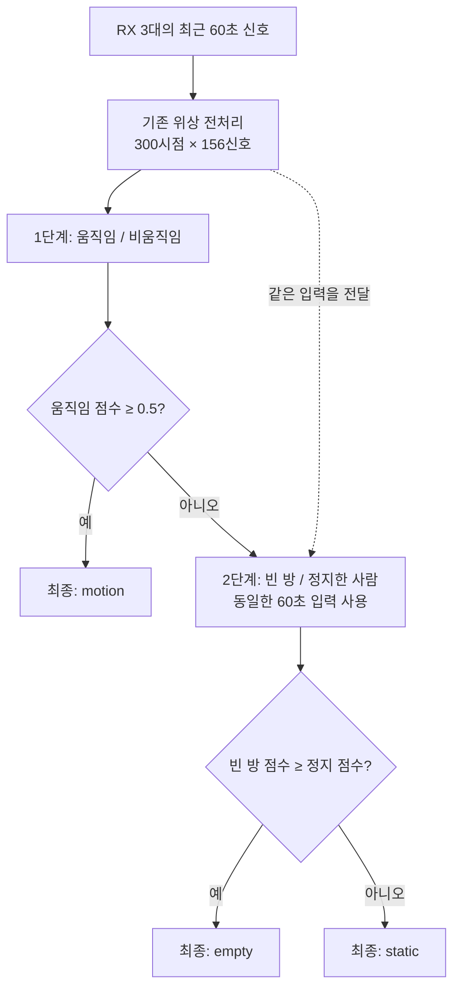

# 위상 60초 모델의 2단계 분류 설계

> 상태: **PLANNED** — 설계만 작성. 코드 구현·학습·실시간 연결은 추후 진행한다.
> 작성일: 2026-10-12
> 목표: 먼저 움직임 여부를 판단하고, 움직임이 아니면 빈 방과 정지한 사람을 구분한다.

2026-10-13 우선 작업은 [기존 3클래스 모델의 새 방 파인튜닝·실시간 시험](phase60-room-finetuning.md)으로 전환했다. 이 문서는 후속 후보 설계로 보존한다.

## 1. 전체 구조 — 모델 두 종류가 역할을 나눈다

**1단계는 “움직이는가?”, 2단계는 “빈 방인가, 가만히 있는 사람이 있는가?”를 판단한다.** 최종 화면에 표시할 상태는 지금처럼 `empty / static / motion` 세 가지다.

1단계에서 말하는 **비움직임에는 빈 방과 정지한 사람이 모두 포함**된다. 비움직임을 곧바로 빈 방으로 해석하지 않는다. 2단계가 추가 60초를 기다리는 것도 아니다. 두 단계는 같은 시점에 끝나는 같은 60초 입력을 사용한다.

| 단계 | 학습할 질문 | 출력 순서 | 학습 자료 |
|---|---|---|---|
| 1단계 | 움직임인가, 비움직임인가? | `non_motion`, `motion` | empty·static·motion 전부 |
| 2단계 | 빈 방인가, 정지한 사람인가? | `empty`, `static` | empty·static만 |

이 설계는 현재 위상 모델이 두 단계에서 사용할 특징을 제공할 수 있다는 가설을 시험한다. 2단계로 나눈 것 자체가 새 방의 오판을 해결한다는 보장은 없다. 배경은 [쉬운 원인 분석](20261008-phase60-static-diagnosis-easy.md)에 있다.

## 2. 두 단계의 입력

두 단계 모두 [기존 위상 입력](../../phase60/features.py)을 사용한다. 첫 비교에서는 입력과 창 길이를 같게 두어 분류 구조를 나눈 효과를 확인한다.

| 항목 | 설계값 |
|---|---|
| 수신기 | RX101·102·103 |
| 신호 수 | RX당 52개, 총 156개 |
| 원본 톤 순서 | `38~63, 1~26` |
| 입력 길이 | 100Hz 기준 6,000프레임, 60초 |
| 위상 변환 | 주파수축 unwrap과 직선 성분 제거 |
| 시간 줄이기 | 20프레임 평균 → 300시점 |
| 평균 제거 | 각 신호의 창 평균 차감 |
| 모델 입력 | `(B, 300, 156)` — B는 한 번에 처리하는 창 수 |
| 학습·정적 평가 이동 | 300프레임, 3초 |
| 향후 실시간 이동 | 새 공통 입력 30프레임, 기본 0.3초 |

위상 잔차 계산과 창 변환을 두 모델에 중복 구현하지 않는다. 같은 변환 결과를 전달한다. 다만 각 모델의 CNN 가중치는 독립적으로 보관한다.

누락 처리는 기존과 같이 실수·허수 각각 최대 5프레임의 내부 공백만 보간한다. 입력에 채우지 못한 공백·NaN·무한대가 남으면 해당 창은 판단 불가다. 재부팅이나 송신 순번 역행을 가로질러 창을 만들지 않는다. 실시간에는 아직 도착하지 않은 미래 프레임을 사용하지 않는다.

기존 세션 로더는 공통 27,000프레임을 요구한다. 짧은 정답 구간에서 60초 창을 만드는 경로는 별도로 설계·구현하고, 그 변환 결과를 기존 예측 경로와 대조한다. 기존 로더를 그대로 쓰면 3분 구간을 처리할 수 있다고 가정하지 않는다.

## 3. 각 모델 내부 구조

두 단계 모두 기존 [공유 시간 CNN](../../cnn1d/shared_cnn.py)과 같은 층 구성을 사용하고, 마지막 출력만 2개로 만든다. 단계마다 별도 모델을 둔다.

| 처리 | 신호 하나 기준 출력 | 설정 |
|---|---|---|
| 입력 | 1채널 × 300시점 | 156개 신호를 같은 CNN 규칙으로 처리 |
| Conv → BatchNorm → ReLU | 16채널 × 300시점 | 커널 5, stride 1, padding 2 |
| MaxPool | 16채널 × 150시점 | 커널 2, stride 2, padding 0 |
| Conv → BatchNorm → ReLU | 32채널 × 150시점 | 커널 5, stride 1, padding 2 |
| MaxPool | 32채널 × 75시점 | 커널 2, stride 2, padding 0 |
| Conv → BatchNorm → ReLU | 32채널 × 75시점 | 커널 3, stride 1, padding 1 |
| 시간축 평균·표준편차 | 신호당 특징 64개 | 채널마다 75시점을 요약 |
| 신호축 평균·표준편차 | 창당 특징 128개 | 같은 특징끼리 156개 신호를 요약 |
| 분류 부분 | 128 → 64 → 2 | 중간 ReLU, Dropout 0.2 |

“공유 CNN”은 한 단계 안에서 156개 신호에 같은 가중치를 쓴다는 뜻이다. **1단계와 2단계가 학습 가중치를 공동으로 수정한다는 뜻은 아니다.**

기존 방식처럼 seed 0·1·2로 세 번 학습한다. 따라서 저장할 네트워크는 1단계 3개, 2단계 3개로 총 6개다. 먼저 각 단계 안에서 세 모델의 softmax 점수를 평균한 다음 분기한다. seed마다 먼저 분기한 뒤 다수결하는 방식은 사용하지 않는다.

## 4. 실제 판정 규칙

1. 1단계 모델 3개의 점수를 평균해 움직임 점수 `m`을 구한다.
2. `m ≥ 0.5`면 최종 상태를 `motion`으로 결정한다. 이때 2단계 실행은 생략한다.
3. `m < 0.5`면 같은 입력을 2단계에 넣는다.
4. 2단계 모델 3개의 점수를 평균한다. empty 점수가 static 이상이면 `empty`, 그 외에는 `static`이다.

첫 실험의 경계는 0.5로 고정한다. 시험 점수를 본 뒤 경계를 바꾸지 않는다. 추후 경계 조정이 필요하면 검증 자료에서만 선택하고 별도 설정으로 기록한다.

| 가상 예시 | 1단계 움직임 점수 | 2단계 empty / static 점수 | 최종 결과 |
|---|---:|---|---|
| 걷는 신호 | 0.80 | 실행 생략 | motion |
| 빈 방 신호 | 0.15 | 0.85 / 0.15 | empty |
| 앉은 신호 | 0.20 | 0.10 / 0.90 | static |

점수는 모델이 내는 판단 수치이며 실제 정답 확률로 보정된 값은 아니다.

### 1단계가 틀리면 어떤 일이 생기는가

실제 static을 1단계에서 motion으로 판단하면 2단계가 이를 고칠 기회가 없다. 반대로 실제 motion을 비움직임으로 보내면, 2단계는 학습하지 않은 움직임 입력을 받아 empty나 static 중 하나를 선택하게 된다.

따라서 2단계의 empty/static 정확도만 높다고 전체 모델이 좋아졌다고 결론 내리지 않는다. 1단계에서 잘못 분기한 사례까지 최종 오답에 포함한다.

## 5. 어떤 자료로 학습하는가

### 정답을 단계별로 변환한다

| 원본 정답 | 1단계 학습 정답 | 2단계 학습 정답 |
|---|---|---|
| empty | non_motion | empty |
| static | non_motion | static |
| motion | motion | 사용하지 않음 |

**2단계 학습 자료는 실제 정답이 empty/static인 창으로 고른다.** 1단계 모델이 비움직임으로 예측한 창만 골라 학습하면 1단계의 오판이 학습 자료에 섞일 수 있다.

### 기존 자료와 새 방 자료의 역할

- 기존 9/19·20의 60세션은 추가 학습용 자료로 사용할 수 있다. 1단계는 60세션 전체, 2단계는 그중 empty/static 40세션이 대상이다. 품질 검사 후 실제 사용 수를 기록한다.
- 새 방 학습 자료도 포함한다. 1단계에는 새 방의 세 상태가 모두 필요하고, 2단계에는 새 방 empty/static만 사용한다.
- 검증은 별도 새 방 녹화, 최종 시험은 다른 날의 새 방 녹화로 한다.
- 기존 9/16·17의 15세션은 과거 환경 성능 확인용이다. 이미 반복해서 살펴본 자료이므로 새로운 독립 시험으로 부르지 않는다.
- 10/6 전환 자료는 재생·진단 비교용이다. 새 방 적응의 최종 독립 시험에는 쓰지 않는다.

출발 모델은 기존 60세션을 이미 학습했다. **그 60세션 일부를 지금 검증용으로 떼어도, 출발 모델이 처음 보는 자료가 되지는 않는다.** 출발 모델이 학습한 원본도 분할 검사에 포함한다.

새 방 자료의 첫 수집량은 [기존 수집 계획](../../../doc/plans/2026-10-12-phase60-room-finetuning.md)의 제안을 따른다. 세 상태를 각각 3분 유지하는 녹화를 학습 2회, 검증 1회, 다른 날 시험 2회 수집한다. 안정 상태 합계 45분이며 이동·준비 시간은 별도다. 이 양은 첫 소규모 시험용이고 충분한 성능을 보장하지 않는다.

### 자료 분리와 구간 규칙

- 녹화 전체를 하나의 분할에 배정한다. 같은 녹화의 겹치는 창을 학습과 평가로 나누지 않는다.
- 단일 상태 세션 정답은 `session.json`에서 읽는다. 실시간 혼합 녹화는 원본 ID에 연결된 별도 정답 구간표를 사용한다.
- 60초 전체가 같은 안정 상태 안에 있는 창만 정적 학습·평가에 사용한다. 이동·착석 경계와 시각이 불확실한 구간은 별도로 표시한다.
- 중복 원본, 경로만 다른 복사본, 출발 모델 학습 자료와의 중복을 검사한다.
- 보간 문맥을 포함해 검증·시험 자료의 프레임이 학습 입력에 섞이지 않게 한다. 별도 녹화 간 보간은 하지 않는다.

## 6. 학습 순서

### 시작 가중치

`model_train/phase60/model_60sessions.pt`의 각 seed에서 CNN과 `128→64` 층을 가져와 두 단계에 각각 복사한다. 마지막 `64→3` 층은 각 단계의 `64→2` 층으로 교체하고 새로 초기화한다. 두 단계의 출력 층 초기화 난수는 각각 기록한다.

기존 출력에서 motion 항목을 지우거나 점수를 합치는 것만으로 학습 완료로 보지 않는다. 두 판정부 모두 자신의 이진 정답으로 추가 학습한다.

### 첫 학습: 분류 부분만 조정

- CNN 가중치와 BatchNorm의 가중치·내부 평균·분산을 고정한다. 분류 부분 `128→64→2`만 학습한다.
- 1단계와 2단계는 각자의 이진 cross-entropy 손실로 따로 학습한다. 두 단계 사이로 오차를 역전파하지 않는다.
- 두 단계 모두 Adam, 학습률 `1e-4`, 배치 32, 최대 20 epoch로 시작한다. 검증 점수가 5 epoch 동안 개선되지 않으면 중단한다.
- 1단계는 검증의 motion/non_motion 정답률 평균, 2단계는 정답이 empty/static인 검증 창의 두 정답률 평균으로 최적 epoch를 선택한다. 점수가 같으면 검증 손실이 낮은 쪽, 그마저 같으면 먼저 도달한 epoch를 택한다.
- 각 단계에서 기존/새 방 출처를 1:1로 뽑는다. 1단계의 출처별 목표 비중은 motion 50%, empty 25%, static 25%다. 2단계는 empty/static 50%씩이다. 중복 추출 여부와 실제 수를 기록한다.

새 방 motion이 없으면 이 단계의 1단계 적응 학습을 완료했다고 표시하지 않는다. 검증에서 필요한 클래스가 없거나 유효 창이 없으면 점수 0으로 조용히 대체하지 않고 자료 부족을 보고한다.

### 검증에서 부족할 때의 두 번째 후보

마지막 Conv 층까지 추가 학습하는 후보를 비교한다. 앞쪽 CNN과 모든 BatchNorm은 고정한다. 마지막 Conv 학습률은 `1e-5`, 분류 부분은 `1e-4`로 둔다. 첫 비교는 두 단계 모두 분류 부분만 학습한 조합과, 두 단계 모두 마지막 Conv까지 학습한 조합으로 제한한다.

각 단계의 최적 epoch를 고른 뒤 3-seed 평균과 0.5 분기를 적용한다. **전체 3분류의 검증 점수로 두 조합 중 하나를 선택**하고, 선택한 조합과 가중치를 고정한 후 최종 시험을 연다. 검증 점수가 같으면 변경 범위가 작은 첫 후보를 선택한다.

## 7. 무엇을 평가하는가

| 평가 | 사용할 자료 | 확인할 내용 |
|---|---|---|
| 1단계 단독 | 세 상태 전체 | motion을 놓치는 비율, empty/static을 motion으로 보내는 비율 |
| 2단계 단독 | 실제 정답이 empty/static인 창 전체 | 1단계가 맞았다고 가정했을 때의 empty/static 구분 능력 |
| 전체 연결 | 세 상태 전체, 실제 분기 적용 | 최종 3×3 혼동표, 클래스별 정답률과 그 평균 |
| 실제 전환 | 별도 입실·걷기·앉기·퇴실 녹화 | 첫 정답 반응, 다시 오판한 구간, 판단 불가 시간 |

2단계 단독 진단에서는 1단계가 motion으로 잘못 보낸 empty/static 창도 2단계에 넣어본다. 이때만 실제 정답으로 진단 대상을 고르며, 그 결과는 실제 운영 정확도와 구분한다. 최종 시험의 전체 연결에서는 정답으로 분기를 고치지 않는다.

비교 기준은 고정된 기존 위상 3분류 모델이다. 같은 입력 창에서 두 모델을 평가하고, 전체 유효 창 기준 점수와 녹화별 점수를 함께 낸다. 창 수·제외 수·이유도 보고한다. 겹치는 창 수를 독립 시험 횟수처럼 해석하지 않는다.

이전 계획의 초기 운영 기준을 전체 연결 결과에 적용한다. 빈 방·정지 정답률 평균 10%p 이상 개선, 빈 방·motion 각각의 정답률 하락 5%p 이내, 두 새 방 시험 녹화 각각의 빈 방·정지 평균 비악화, 기존 15세션의 세 클래스 평균 정답률 하락 5%p 이내를 제안한다. 수집 전에 기준을 확정한다. 이는 통계적 보장이나 실사용 안정성 인증이 아니다.

하나의 녹화에 세 상태가 섞이므로 녹화 전체에 정답 하나를 붙여 세션 정확도를 구하지 않는다. 안정 상태 구간별로 집계한다. 전환 구간은 60초 동안 이전 상태가 섞일 수 있으므로 정적 점수와 별도로 평가한다.

## 8. 저장과 향후 실시간 연결

새 모델 종류의 제안 이름은 `phase60_two_stage`다. 하나의 묶음에 단계별 seed 3개의 가중치, 단계별 클래스 순서, 입력 규격, 분기 기준 0.5, 초기 모델 해시, 학습/검증 목록, 선택 근거를 저장한다. 기존 위상 체크포인트와 구분되는 형식 식별자를 사용한다.

예측 결과는 다음 내용을 명시적으로 전달하도록 설계한다.

- 최종 라벨 `empty / static / motion` 또는 입력 부족·오류 상태.
- 1단계의 `non_motion / motion` 점수.
- 2단계를 실행했는지, 실행했다면 `empty / static` 점수. 생략했다면 점수는 null.
- 분기 기준, 입력 시작·끝 송신 순번, 두 단계의 모델 버전·해시, 처리 시간.

현재 상태 기계는 세 클래스 점수 중 가장 큰 값을 골라 라벨을 만든다. **2단계 구조에서는 분기로 결정한 라벨을 받아야 한다.** 단계별 점수를 억지로 기존 3개 점수 칸에 넣고 다시 가장 큰 값을 고르면 다른 결론이 날 수 있다.

예를 들어 움직임 점수가 0.45이고 2단계가 empty/static 각각 0.5라면 이 설계는 empty를 선택한다. 그런데 비움직임 점수 0.55에 두 점수를 곱해 `[0.275, 0.275, 0.45]`를 만들고 최대값을 고르면 motion이 된다. 따라서 첫 구현에서는 이런 합성 점수의 최대값으로 최종 라벨을 재계산하지 않는다. 화면에는 단계별 점수와 최종 분기를 표시하며 이를 통합 정답 확률이라고 부르지 않는다.

기존 `phase60` 로더는 이 새 묶음을 읽는 용도로 쓰지 않는다. 전용 로더·실시간 모델 선택·상태 표시·기록 규격을 함께 구현하고, 기존 진폭/위상 동작의 회귀 검사를 수행해야 한다.

60초 입력 준비 후 동일한 창을 두 단계가 사용한다. 비움직임 경로에서는 두 단계의 CNN 추론 시간이 들기 때문에 전체 처리 시간을 실제로 측정한다. 0.3초 이동 설정만으로 처리 속도나 행동 전환 지연을 보장하지 않는다. 입력이 부족하거나 어느 필요한 단계에서 계산이 실패하면 최종 클래스를 억지로 내지 않고 판단 불가 사유를 기록한다.

## 9. 구현할 때의 작업 순서와 완료 기준

- [ ] 단계별 라벨 변환·정답 구간·녹화 분할 검사 구현.
- [ ] 2출력 모델 초기화와 단계별 독립 학습, CNN·BatchNorm 동결 검사 구현.
- [ ] seed 평균 후 분기, 0.5 경계·동점·2단계 생략·계산 실패 검사 구현.
- [ ] 단계별 진단과 실제 분기를 포함한 전체 평가 구현.
- [ ] 전용 체크포인트 저장·읽기 후 같은 입력의 같은 점수·라벨 재현 확인.
- [ ] 합성 소규모 자료로 학습→저장→불러오기→분기의 실행 경로 검사.
- [ ] 새 방 자료 확보 후 실제 학습·검증·다른 날 시험 수행.
- [ ] 통과한 후보를 GUI·CLI에 연결하고 실제 전환 시험 수행.

**현재 완료 범위는 이 설계 문서까지다.** 합성 자료의 실행 확인은 실제 성능 평가를 대신하지 않는다. 다음 구현 시 입력 규격은 [기존 위상 계약](../../phase60/README.md), 새 분기·출력 규칙은 이 문서를 기준으로 한다.
