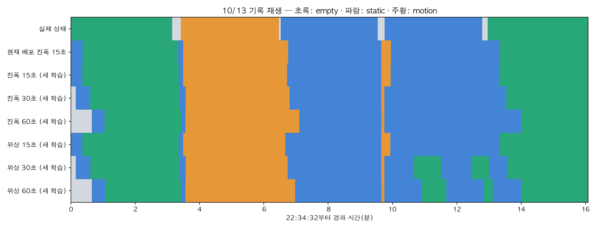

# 10월 13일 기록으로 비교한 여섯 상태 모델

> 상태: **SUPPORTING ANALYSIS** — 2026-10-30. 여섯 후보 × seed 3개 전체 학습 및 7구성 재생 평가 완료.

**10/6 기록은 사용하지 않았다.** 삼각대를 사용한 10/13 22:34 기록 한 건만 평가했다.
[평가 계획](pilot-live-comparison-plan.md)에 따라 새 후보는 9월 74세션으로 학습했다. 현재 배포 진폭 15초 가중치는 별도 기준으로 남겼다. 모델·GUI 기본값은 교체하지 않았다.

## 1. 비교 조건

- 상태 모델: 진폭/위상 × 15/30/60초, 각각 seed 3개 확률 평균.
- 빠른 움직임 검출: 현재 진폭 3초 가중치 고정. 연속 3회 motion 확률 0.9 이상이면 motion 후보 우선.
- 상태 기계: 확신 0.6, motion 1초, rest 5초, empty↔static 직접 전환 10초. 0.3초 간격.
- 중문 밖 정지는 static이다. 이동·문 여닫기 등 정답 미지정 구간은 점수에서 제외했다.
- 원본의 TX 순번을 100Hz로 환산한 재생이다. 실제 USB 도착 지연·GUI 표시 지연을 재현한 온라인 시험이 아니다.

## 2. 최종 표시 성능 — 3초 모델과 상태 기계 포함

각 행동 시작 후 **60초를 모든 후보에 공통으로 제외한 623초**를 안정 상태 비교로 쓴다. 구간 전체 923초도 함께 공개한다. 일치율은 정답을 표시한 시간/평가 시간이며 판단 불가도 분모에 포함한다.

| 상태 모델 | 구간 전체 일치율 | 60초 이후 일치율 | 이후 empty | 이후 static | 이후 motion | 이후 판단 불가(초) |
|---|---:|---:|---:|---:|---:|---:|
| 현재 배포 진폭 15초 | 92.0% | 100.0% | 100.0% | 100.0% | 100.0% | 0.0 |
| 진폭 15초 (새 학습) | 92.3% | 100.0% | 100.0% | 100.0% | 100.0% | 0.0 |
| 진폭 30초 (새 학습) | 89.5% | 100.0% | 100.0% | 100.0% | 100.0% | 0.0 |
| 진폭 60초 (새 학습) | 81.6% | 99.1% | 97.7% | 100.0% | 100.0% | 0.0 |
| 위상 15초 (새 학습) | 92.7% | 100.0% | 100.0% | 100.0% | 100.0% | 0.0 |
| 위상 30초 (새 학습) | 82.4% | 89.3% | 100.0% | 72.5% | 100.0% | 0.0 |
| 위상 60초 (새 학습) | 78.4% | 91.4% | 96.9% | 81.1% | 100.0% | 0.0 |

## 3. 상태 모델만의 성능

새 예측이 가능한 틱의 argmax를 평가했다. 창이 유효하지 않은 틱은 판단 불가로 기록했다. 최종 표시 쪽은 기존 엔진처럼 이전 상태를 유지하므로, 두 표의 차이가 전부 모델 성능 개선을 뜻하지는 않는다.

| 상태 모델 | 전체 중 새 추론 가능 틱 | 60초 이후 전체시간 일치율 | 60초 이후 판단가능시간 일치율 |
|---|---:|---:|---:|
| 현재 배포 진폭 15초 | 3030/3352 | 91.3% | 99.5% |
| 진폭 15초 (새 학습) | 3030/3352 | 91.8% | 100.0% |
| 진폭 30초 (새 학습) | 2991/3352 | 92.1% | 100.0% |
| 진폭 60초 (새 학습) | 2889/3352 | 91.4% | 100.0% |
| 위상 15초 (새 학습) | 3030/3352 | 83.4% | 90.9% |
| 위상 30초 (새 학습) | 2991/3352 | 81.9% | 88.9% |
| 위상 60초 (새 학습) | 2889/3352 | 81.9% | 89.6% |

## 4. 행동별 최종 표시와 반응

지연은 기록된 행동 시작부터 10초 연속 정답 표시가 시작할 때까지다. 이미 올바른 상태였다면 0초가 가능하다. 정확한 이동 시작/종료 시각이 없으므로 순수한 모델 전환 지연으로 해석하지 않는다.

| 모델 | 구간 | 60초 이후 일치율 | 첫 정답(초) | 10초 유지 시작(초) |
|---|---|---:|---:|---:|
| 현재 배포 진폭 15초 | 집 밖 1 | 100.0% | 22.2 | 22.2 |
| 현재 배포 진폭 15초 | 걷기 | 100.0% | 4.1 | 4.1 |
| 현재 배포 진폭 15초 | 침대 정지 | 100.0% | 14.0 | 14.0 |
| 현재 배포 진폭 15초 | 중문 밖 정지 | 100.0% | 11.7 | 11.7 |
| 현재 배포 진폭 15초 | 집 밖 2 | 100.0% | 21.9 | 21.9 |
| 진폭 15초 (새 학습) | 집 밖 1 | 100.0% | 21.6 | 21.6 |
| 진폭 15초 (새 학습) | 걷기 | 100.0% | 4.1 | 4.1 |
| 진폭 15초 (새 학습) | 침대 정지 | 100.0% | 12.2 | 12.2 |
| 진폭 15초 (새 학습) | 중문 밖 정지 | 100.0% | 11.4 | 11.4 |
| 진폭 15초 (새 학습) | 집 밖 2 | 100.0% | 21.3 | 21.3 |
| 진폭 30초 (새 학습) | 집 밖 1 | 100.0% | 36.0 | 36.0 |
| 진폭 30초 (새 학습) | 걷기 | 100.0% | 8.9 | 8.9 |
| 진폭 30초 (새 학습) | 침대 정지 | 100.0% | 16.7 | 16.7 |
| 진폭 30초 (새 학습) | 중문 밖 정지 | 100.0% | 0.0 | 0.0 |
| 진폭 30초 (새 학습) | 집 밖 2 | 100.0% | 35.1 | 35.1 |
| 진폭 60초 (새 학습) | 집 밖 1 | 98.1% | 62.4 | 62.4 |
| 진폭 60초 (새 학습) | 걷기 | 100.0% | 8.6 | 8.6 |
| 진폭 60초 (새 학습) | 침대 정지 | 100.0% | 35.3 | 35.3 |
| 진폭 60초 (새 학습) | 중문 밖 정지 | 100.0% | 0.0 | 0.0 |
| 진폭 60초 (새 학습) | 집 밖 2 | 97.4% | 63.3 | 63.3 |
| 위상 15초 (새 학습) | 집 밖 1 | 100.0% | 21.6 | 21.6 |
| 위상 15초 (새 학습) | 걷기 | 100.0% | 4.1 | 4.1 |
| 위상 15초 (새 학습) | 침대 정지 | 100.0% | 8.9 | 8.9 |
| 위상 15초 (새 학습) | 중문 밖 정지 | 100.0% | 10.5 | 10.5 |
| 위상 15초 (새 학습) | 집 밖 2 | 100.0% | 21.6 | 21.6 |
| 위상 30초 (새 학습) | 집 밖 1 | 100.0% | 36.3 | 36.3 |
| 위상 30초 (새 학습) | 걷기 | 100.0% | 8.9 | 8.9 |
| 위상 30초 (새 학습) | 침대 정지 | 100.0% | 13.4 | 13.4 |
| 위상 30초 (새 학습) | 중문 밖 정지 | 45.2% | 0.0 | 0.0 |
| 위상 30초 (새 학습) | 집 밖 2 | 100.0% | 0.0 | 36.0 |
| 위상 60초 (새 학습) | 집 밖 1 | 96.7% | 64.2 | 64.2 |
| 위상 60초 (새 학습) | 걷기 | 100.0% | 8.6 | 8.6 |
| 위상 60초 (새 학습) | 침대 정지 | 100.0% | 26.9 | 26.9 |
| 위상 60초 (새 학습) | 중문 밖 정지 | 62.4% | 0.0 | 0.0 |
| 위상 60초 (새 학습) | 집 밖 2 | 97.2% | 0.0 | 63.6 |

## 5. 시간별 최종 표시

회색은 정답 미지정 또는 판단 준비/정지다. 원본 시계 기반 재생 결과이며 실제 당시 화면 영상은 아니다.



## 6. 해석과 한계

이 한 기록의 안정 상태 전체시간 일치율 최고는 **100.0%**이며, 현재 배포 진폭 15초·진폭 15초 (새 학습)·진폭 30초 (새 학습)·위상 15초 (새 학습)가 공동으로 기록했다.
구간 전체에서는 위상 15초 92.7%, 새 진폭 15초 92.3%, 현재 진폭 15초 92.0%로 차이가 작다. 이 한 건으로 교체를 정할 근거는 약하다. 현재 15초 진폭+3초 움직임 구성을 유지하는 것을 권한다.
60초 진폭은 정답이 안정된 뒤에는 잘 맞혔지만 집 밖 상태를 10초 연속 유지하기 시작한 시점이 약 62~63초 뒤였다. 현재 15초 진폭은 약 22초였다. 위상 30/60초는 중문 밖 static을 empty로 오판하는 구간이 남았다. 9월 파일럿의 긴 창 우세가 이번 전환 기록의 우세로 이어지지는 않았다.
당시 로그 wall 시각과 프레임 시계의 차이는 중앙값 약 0.84초(약 0.75~0.95초)였다. 평가 시간축을 결과에 맞춰 보정하지 않았으며 아래 ±1초 민감도를 함께 제시한다.
점수 차이가 있더라도 한 사람·한 배치·한 번의 녹화로 일반 성능을 단정할 수 없다. 이 기록은 과거에도 검토됐으며 이번 후보 비교에 사용했으므로 새로운 독립 최종 시험이 아니다.
9월 파일럿 순위와 달라도 오류가 아니다. 9월은 상태별 수집 세션의 날짜 제외 평가이고, 이번은 74세션 전체 학습 모델을 다른 방의 상태 전환 기록에 적용한 비교다.
입력이 유효하지 않은 틱에도 상태 기계는 기존 표시와 후보 시각을 유지한다. 최종 표시 일치율과 매번 새로 추론한 비율은 반드시 따로 읽는다.

### 시간축 ±1초 민감도

| 모델 | 구간 전체 일치율 범위 |
|---|---:|
| 현재 배포 진폭 15초 | 91.4%~92.5% |
| 진폭 15초 (새 학습) | 91.8%~92.9% |
| 진폭 30초 (새 학습) | 89.0%~89.9% |
| 진폭 60초 (새 학습) | 81.1%~82.0% |
| 위상 15초 (새 학습) | 92.2%~93.3% |
| 위상 30초 (새 학습) | 82.1%~82.6% |
| 위상 60초 (새 학습) | 78.0%~78.7% |

## 7. 근거와 재현

- [전체 지표](assets/pilot-live/results.json)
- [원본·모델·평가 코드 해시](assets/pilot-live/identity.json)
- [시간축 진단](assets/pilot-live/timing.json)
- [현재 실시간 창 생성기와 대조](assets/pilot-live/prefix-checks.json)
- [실험 브랜치에서 보존한 정답 근거 원문](assets/pilot-live/truth-source.txt)

```bash
.venv/bin/python model_train/pilot75/train_full.py --device mps
.venv/bin/python model_train/pilot75/evaluate_live.py --device mps
MPLCONFIGDIR=/private/tmp/pilot-live-mpl .venv/bin/python model_train/pilot75/report_live.py
```

모델은 `model_train/pilot75/runs/live20261030/models/`, 시간별 확률과 상태는 `model_train/pilot75/runs/live20261030/evaluation/`에 있다. 10/6 자료는 읽거나 평가하지 않았다.
